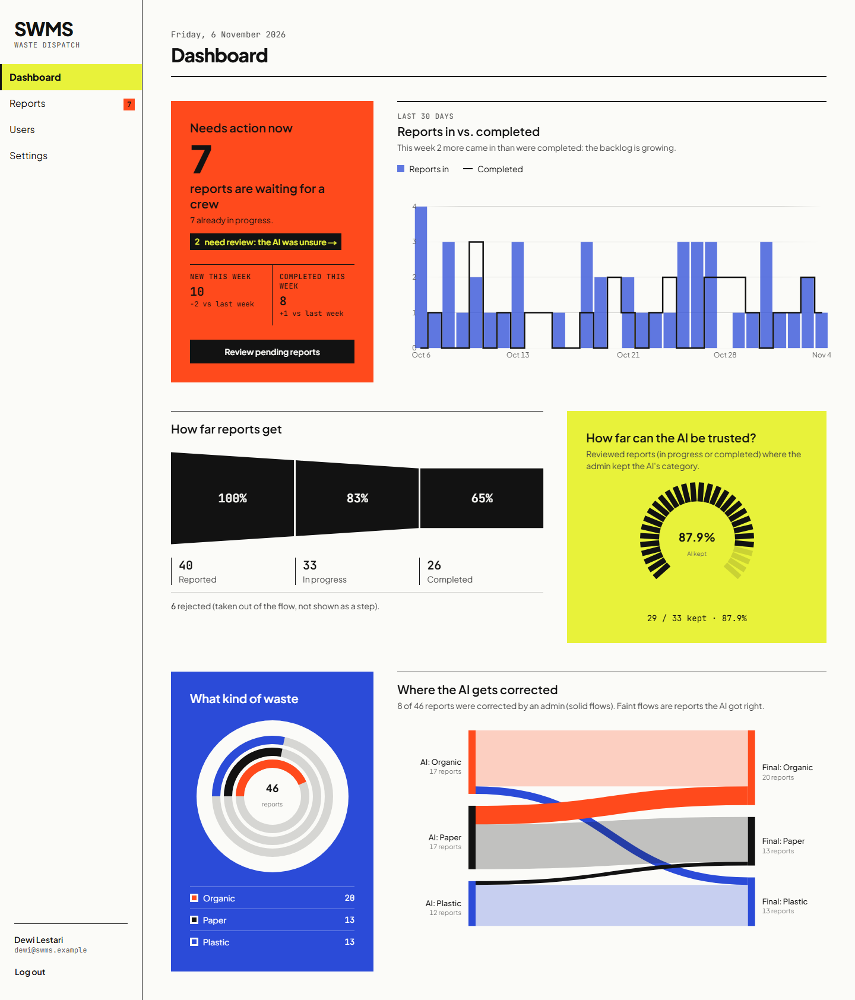
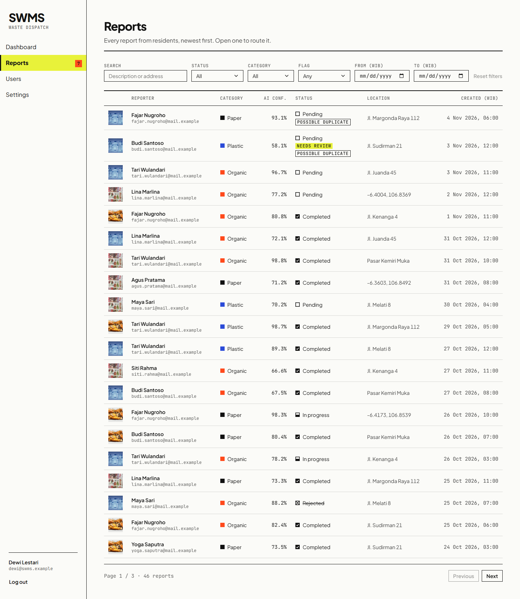
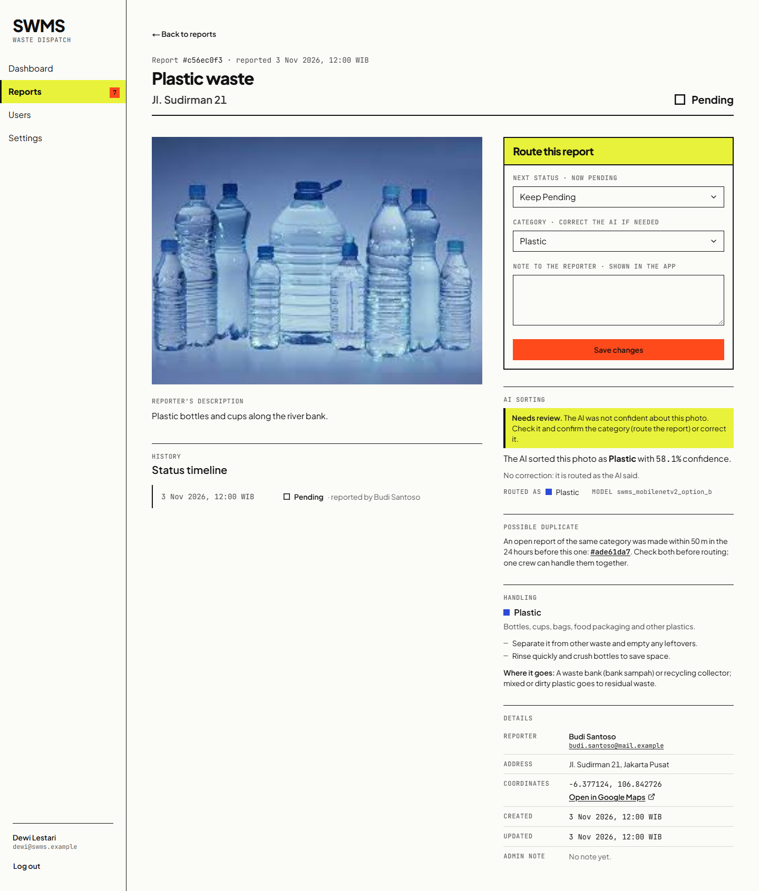
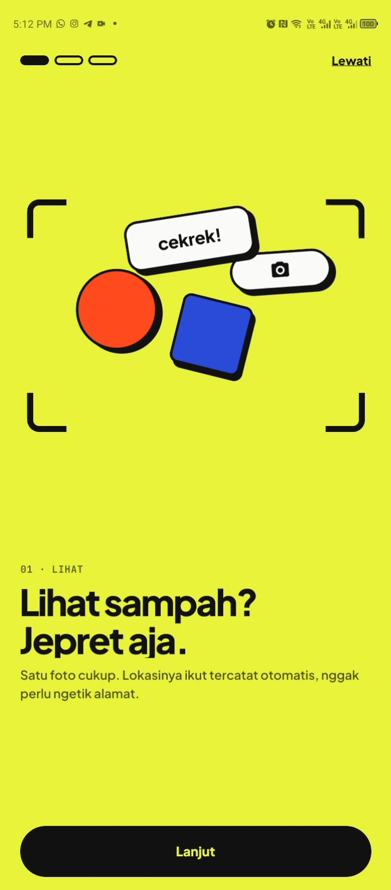
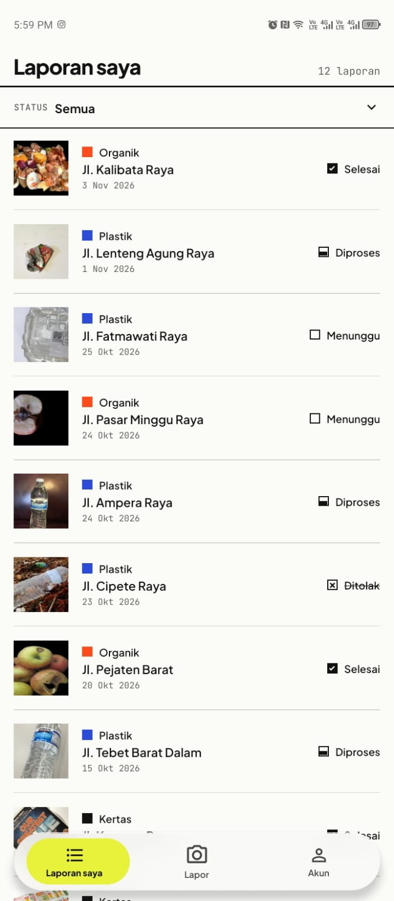
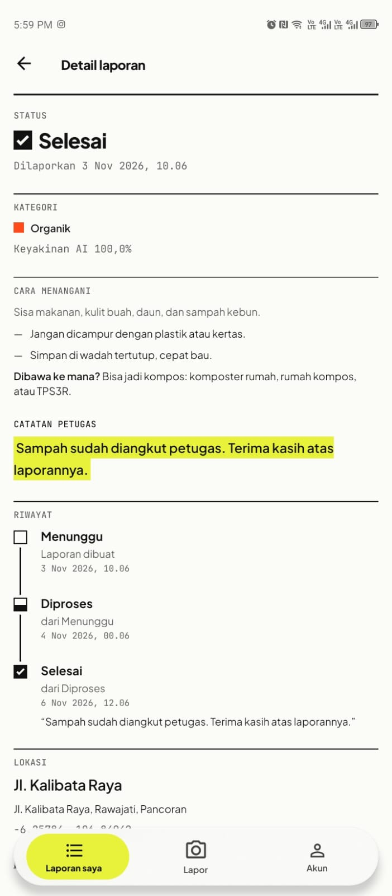
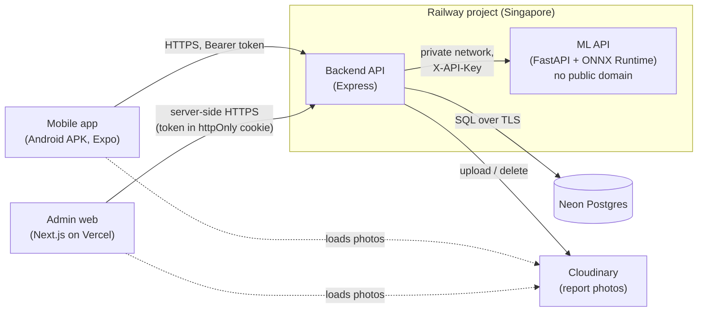

# Smart Waste Management System (SWMS)

Residents are the eyes, the AI is the sorter, admins are the dispatchers. A resident sees waste lying around,
takes a photo in the Android app, and the app adds the GPS location. The backend sends the photo to an image
classifier that sorts it into **organic**, **paper** or **plastic**, and the report lands in the admin web panel.
An admin checks the AI's category (correcting it if needed), routes the report through
`pending → in_progress → completed` (or `rejected` with a note), and the resident follows that status in the app.
The problem it addresses: waste reports that arrive unsorted, without a location and without feedback to the
person who reported them.

## Live demo

| | |
|---|---|
| Admin web panel | https://smart-waste-system-management.vercel.app |
| Android APK | [GitHub Releases → latest](https://github.com/jieffrey/Smart-Waste-System-Management/releases/latest) |
| Backend health | https://smart-waste-system-management-production-c94d.up.railway.app/api/health → `{"status":"ok"}` |

Demo credentials (one admin, one resident) are in the submission email. They are not in this repository.

The ML API has no public URL: only the backend can reach it, over Railway's private network.

## Screenshots

Admin web panel (1440 px, [mock data](tools/screenshots/)):

| Dashboard | Reports list | Report detail |
|---|---|---|
|  |  |  |

Resident app (Android phone):

| Onboarding | My reports | Report detail |
|---|---|---|
|  |  |  |

All web pages at 1440 px and 390 px are in [`docs/screenshots/final/web/`](docs/screenshots/final/web/).

## Features

### Resident (mobile app, Android; UI in Bahasa Indonesia)

- **Onboarding:** three animated slides on first launch, skippable (**Lewati**), replayable from settings.
- **Account:** register, log in, log out; the session is restored on start (token in `expo-secure-store`).
- **Email verification (OTP):** a 6-digit code screen with a resend countdown. Only active when the backend runs
  with `OTP_ENABLED=true` (off by default). In the live demo it is **TODO: on / off**.
  <!-- TODO(owner): fill in whether OTP_ENABLED is on in the deployed demo. -->
- **New report:** photo from camera or gallery (resized to 1600 px, JPEG), GPS location with an editable address,
  description. After submitting, the app shows the AI category and confidence.
- **Low-confidence message:** when the AI is unsure (see *needs review* below), the result says an officer will
  check it manually.
- **Handling guidance:** per category, what it is, how to handle it and where it can go (compost, waste bank,
  collector), on the AI result and the report detail.
- **Possible-duplicate note** after submitting, when a matching open report already exists nearby.
- **My reports:** status filter, pull to refresh, infinite scroll. Reports with an update the owner hasn't opened
  yet get a **Baru** ("new") tag, and the tab shows the count.
- **Report detail:** photo, status timeline with admin notes, AI category and confidence (and the AI's original
  guess if an admin corrected it), Open in Maps.
- **Account settings:** edit name and email, change password, replay the guide, log out.

### Admin (web panel)

- **Dashboard:** totals by status and category, reports and completions per day (30 days, Asia/Jakarta), AI
  accuracy on reviewed reports, a Sankey chart from AI category to current category, and the needs-review count.
- **Reports list:** filters for status, category, date range, text search, *needs review* and *possible
  duplicate*.
- **Report detail:** reporter, photo, location, AI result, status history with who changed what. Change status
  (only allowed transitions; a note is required to reject), correct the category (the original AI prediction is
  kept), add a note. Handling guidance for the category, and links between a report and its possible duplicates
  in both directions.
- **Users:** list and search users with their report count; activate or deactivate accounts (a deactivated
  user's token stops working at once; an admin can't deactivate their own account).
- **Settings:** edit profile, change password, log out.

### AI

- **Classification on upload:** every new report's photo is classified by the ML API before anything is stored.
  If the ML API is down, the report is not saved (`503`) and the app keeps the form filled in.
- **Needs review:** a report needs review when `ai_confidence < AI_REVIEW_THRESHOLD` (default `0.70`) and no
  admin has confirmed or corrected it yet (still `pending`, category unchanged). It is computed in SQL, not
  stored.
- **Possible duplicate:** on creation, the backend links a report to the nearest **open** report with the **same
  category**, created in the **last 24 hours**, within **50 m** (haversine). Nothing is blocked; the link is a hint
  for the admin.
- **AI accuracy:** the share of reviewed reports (`in_progress` / `completed`) whose category the admin left as
  the AI predicted it.

## Architecture



| Component | Folder | Stack |
|---|---|---|
| Mobile app (residents) | [`Mobile/`](Mobile/) | Expo SDK 58, React Native 0.88, Expo Router, TypeScript, React Native Paper; APK built with EAS |
| Admin web | [`web/`](web/) | Next.js 16 (App Router), React 19, TypeScript, Tailwind CSS 4, shadcn/ui + Radix, Bklit charts (d3) |
| Backend API | [`backend/`](backend/) | Node.js 22, Express 5 (CommonJS), raw parameterized SQL with `pg`, zod, multer, sharp, bcryptjs, JWT |
| ML API | [`ml/`](ml/) | Python 3.12, FastAPI, ONNX Runtime (production) / TensorFlow-Keras (training, local default), Docker |
| Database | [`backend/db/`](backend/db/) | PostgreSQL on Neon; [`schema.sql`](backend/db/schema.sql) + numbered [migrations](backend/db/migrations/) |
| Photo storage | `backend/src/modules/uploads/` | Cloudinary in production (`STORAGE_DRIVER=cloudinary`), local disk in development |

The web panel never calls the backend from the browser: its Next.js server does, so production needs no CORS.

## ML summary

- **Model:** MobileNetV2 (ImageNet weights) with transfer learning, 224×224 RGB input, 3 classes. The served model
  is **Option B**: class weights plus fine-tuning the top of MobileNetV2 (`model_version`
  `swms_mobilenetv2_option_b`).
- **Data:** Kaggle *Garbage Classification V2* (its `biological`, `paper` and `plastic` classes; `biological` is
  used as `organic`), 701 test images.

Results on the test set (first model in brackets, from [`ml/results/option_b/`](ml/results/option_b/)):

| Metric | Option B |
|---|---|
| Test accuracy | **98.29%** (689 of 701) [97.72%] |
| Recall `organic` / `paper` / `plastic` | **0.9800** / **0.9881** / **0.9799** [0.9667 / 0.9881 / 0.9732] |
| Macro F1 | **0.9818** [0.9769] |
| `plastic` → `paper` errors (the main confusion) | **5** of 298 plastic images [8] |

The remaining `plastic` → `paper` errors are printed packaging and thin bags. Both models come from a single
training run each, so there is no variance estimate (see [Known limitations](#known-limitations)).

**Serving:** the Keras model is exported to ONNX (8.9 MB) and served with ONNX Runtime, so the always-on container
doesn't load TensorFlow. The export is only written if it matches Keras on all 4,661 images of the 3 classes (max
probability difference 2.9e-5, 0 label flips). Measured in the production image:

| | TensorFlow runtime | ONNX Runtime (served) |
|---|---|---|
| RAM after startup | 595 MB | **118 MB** |
| RAM after 20 predictions | 708 MB | **143 MB** |
| Docker image (uncompressed) | 3.14 GB | **444 MB** |

The full write-up (dataset, preprocessing, training setup, class imbalance, error analysis, limitations, Option B
comparison) is in the [ML Development Process](ml/README.md#ml-development-process).

## Security

In place:

- **Web session:** the JWT lives in an **httpOnly** cookie (`Secure` in production, `SameSite=Lax`); browser
  JavaScript never sees it. The mobile app keeps its token in `expo-secure-store`.
- **Rate limits** (`429` + `Retry-After`): login per IP and per email (failed attempts), registration, profile
  and password changes, OTP verify/resend, and report creation (20 per user per hour).
- **Passwords:** bcrypt, 8–72 characters, about 100 very common passwords rejected; login timing doesn't reveal
  whether an email exists.
- **Upload limits:** one file, max 5 MB, type checked from the file content (JPEG/PNG/WebP), multipart field
  limits. The ML API also refuses bodies over 5 MB before reading them and images over 24 million pixels before
  decoding.
- **EXIF stripping:** photos are re-encoded with `sharp` before storage, dropping all metadata (including GPS).
- **ML API key:** `/predict` requires `X-API-Key` (constant-time compare); `/docs` is disabled in the image.
- **HTTP security headers:** `helmet` on the backend (CSP off, it serves JSON and images); nosniff,
  `X-Frame-Options: DENY`, Referrer-Policy, HSTS and a Permissions-Policy on the web panel.
- **Private ML network:** the ML service has no public domain; only the backend reaches it over Railway's private
  network.
- **Access control:** parameterized SQL everywhere, allowlisted request bodies, a resident can only see their own
  reports (others get `404`), admin routes need an active admin.

Not in place: a Content-Security-Policy and token revocation (see below). The full white-box review, with the
status of each finding, is in [`docs/security-audit.md`](docs/security-audit.md).

## Run locally

**Prerequisites:** Node.js 22.9+, Python 3.12 with [uv](https://docs.astral.sh/uv/), PostgreSQL 13+ with `psql`
(local, or a Neon branch), and for the app either an Android phone with **Expo Go (SDK 58)** on the same Wi-Fi or
an emulator.

**Env files:** copy each example and fill it in. Never commit the copies.

```bash
cp backend/.env.example backend/.env   # DATABASE_URL, JWT_SECRET (32+ chars), ML_API_URL=http://localhost:8000
cp web/.env.example web/.env           # NEXT_PUBLIC_API_URL=http://localhost:4000
cp Mobile/.env.example Mobile/.env     # EXPO_PUBLIC_API_URL=http://<your LAN IP>:4000 (not localhost)
```

The ML API needs no env file locally (defaults: TensorFlow runtime, port 8000, no API key). Every variable is
described in [`backend/README.md`](backend/README.md#environment-variables) and
[`ml/README.md`](ml/README.md#run-the-api).

**1. Database** (a new, empty database; `schema.sql` already includes every migration):

```bash
cd backend
psql "<connection string>" -v ON_ERROR_STOP=1 -f db/schema.sql
```

**2. ML API** (from `ml/`):

```bash
uv venv .venv --python 3.12
uv pip install -r requirements-dev.txt
.venv/bin/python -m uvicorn src.api.main:app --port 8000      # Windows: .venv\Scripts\python ...
```

**3. Backend** (from `backend/`, port 4000):

```bash
npm ci
npm run db:check    # connection + tables
npm run dev
```

**4. Web** (from `web/`, http://localhost:3000; admin accounts only):

```bash
npm install
npm run dev
```

**5. Mobile** (from `Mobile/`; scan the QR code with Expo Go):

```bash
npm ci
npx expo start
```

The phone must reach the backend on your LAN IP; see [`Mobile/README.md`](Mobile/README.md#setup) for the
Windows firewall rule and the `/api/health` check.

### Seed local demo data

```bash
cd backend
npm run seed        # demo admin + demo user, local only (credentials in backend/README.md, public on purpose)
```

For the 48 demo reports with photos (needs the ML API running; the admin email is the one `npm run seed`
created), [`seed-demo.js`](backend/scripts/seed-demo.js) writes only when `--confirm` names the host in
`DATABASE_URL` (a wrong value makes it print the expected one). `--dry-run` writes nothing. Bash syntax:

```bash
DEMO_ADMIN_EMAIL=<seeded admin email> DEMO_RESIDENT_PASSWORD=<any password> \
  node --env-file=.env scripts/seed-demo.js --dry-run
DEMO_ADMIN_EMAIL=<seeded admin email> DEMO_RESIDENT_PASSWORD=<any password> \
  node --env-file=.env scripts/seed-demo.js --confirm <host in DATABASE_URL, e.g. localhost>
```

Details: [`backend/README.md`](backend/README.md#production-demo-data-seed-demojs).

### Tests

| Suite | Command | Notes |
|---|---|---|
| Backend | `cd backend && npm test` | Node's test runner against the database in `DATABASE_URL`. Point it at a **throwaway** database with the schema loaded, not a shared one. No ML API needed (a fake one is started) |
| ML API | `cd ml && .venv/bin/python -m pytest` | Both runtimes, limits, API key, resize parity, Colab parity on 3 samples |
| Web | `cd web && npm run lint` | ESLint only; there are no web unit tests |
| Mobile | `cd Mobile && npm run lint && npx tsc --noEmit` | ESLint + type check; there are no mobile unit tests |

## Deployment

- **Backend** and **ML API**: two services in one Railway project (Singapore). The ML service builds from
  [`ml/Dockerfile`](ml/Dockerfile) with the ONNX runtime and has no public domain.
- **Web**: Vercel, with `NEXT_PUBLIC_API_URL` set to the backend's Railway domain.
- **Database**: Neon Postgres. Schema changes reach production only through the numbered files in
  `backend/db/migrations/`, run **before** merging the branch that needs them.
- **Photos**: Cloudinary.
- **Mobile**: Android APK from EAS Build (`preview` profile), published on GitHub Releases.

Full plan: [`docs/deploy-plan.md`](docs/deploy-plan.md). Migrations: [`docs/migrations-runbook.md`](docs/migrations-runbook.md).
Email OTP setup: [`docs/email-otp-setup.md`](docs/email-otp-setup.md).

## Repo structure

```
backend/   Express API: src/modules/<feature>/ (routes → controller → service), db/ schema + migrations, scripts/, tests/
ml/        Classifier: training code, notebooks, results/, models/, FastAPI service (src/api), tests/, Dockerfile
web/       Admin panel (Next.js App Router): src/app, src/components, src/lib
Mobile/    Resident app (Expo Router): src/app screens, components, services, store
docs/      Security audit, deploy plan, migrations runbook, OTP setup, design system/review, screenshots/
tools/     Screenshot harness (tools/screenshots)
```

## Known limitations

- **Free / hobby hosting:** Railway Hobby, Vercel, Neon and Cloudinary free tiers. Fine for a demo, not sized for
  real load.
- **No Content-Security-Policy** on the web panel yet (it needs nonces for Next.js scripts).
- **Tokens can't be revoked:** a JWT stays valid until it expires (`JWT_EXPIRES_IN`, default 24 h), also after
  logout or a password change. Only deactivating the account stops it immediately.
- **In-memory rate limits:** they reset on restart and only work with one backend instance. Web admin logins all
  come from the Next.js server, so they share one per-IP counter (the per-email limit still applies).
- **One training run per model:** the Option B gain (4 fewer errors out of 701) has no variance estimate, so its
  size isn't proven.
- **Demo AI accuracy is optimistic:** the 48 demo photos come from the dataset; only 9 are confirmed test-split
  images, the other 39 may have been training images. The dashboard's AI accuracy on demo data overstates how the
  model does on new photos.
- **No "not waste" class:** every photo is forced into organic, paper or plastic, even a selfie. Low confidence
  only marks it for review.

## Credits

- **Dataset:** [Garbage Classification V2](https://www.kaggle.com/datasets/sumn2u/garbage-classification-v2) by
  sumn2u on Kaggle (version 8), **MIT license**. The model was trained on its `biological`, `paper` and `plastic`
  images. The repository includes 3 test samples (`ml/tests/samples/`) and 48 resized, metadata-free demo photos
  (`backend/scripts/demo/photos/`, see [ATTRIBUTION.md](backend/scripts/demo/photos/ATTRIBUTION.md)).
- **Model base:** MobileNetV2 with ImageNet weights, from Keras Applications.
- **Fonts:** [Plus Jakarta Sans](https://fonts.google.com/specimen/Plus+Jakarta+Sans) (Tokotype) and
  [JetBrains Mono](https://www.jetbrains.com/lp/mono/), both SIL OFL 1.1.
- **UI:** [Bklit UI](https://ui.bklit.com) charts, [shadcn/ui](https://ui.shadcn.com) and Radix UI on the web;
  [React Native Paper](https://reactnativepaper.com) on mobile.
- **Other notable libraries:** Next.js, Expo / React Native, Express, `pg`, zod, sharp, multer, d3 (`d3-sankey`),
  Motion, NumberFlow, Lucide icons, FastAPI, ONNX Runtime, TensorFlow / Keras, Pillow, Cloudinary SDK; EmailJS (REST API)
  (OTP emails).
