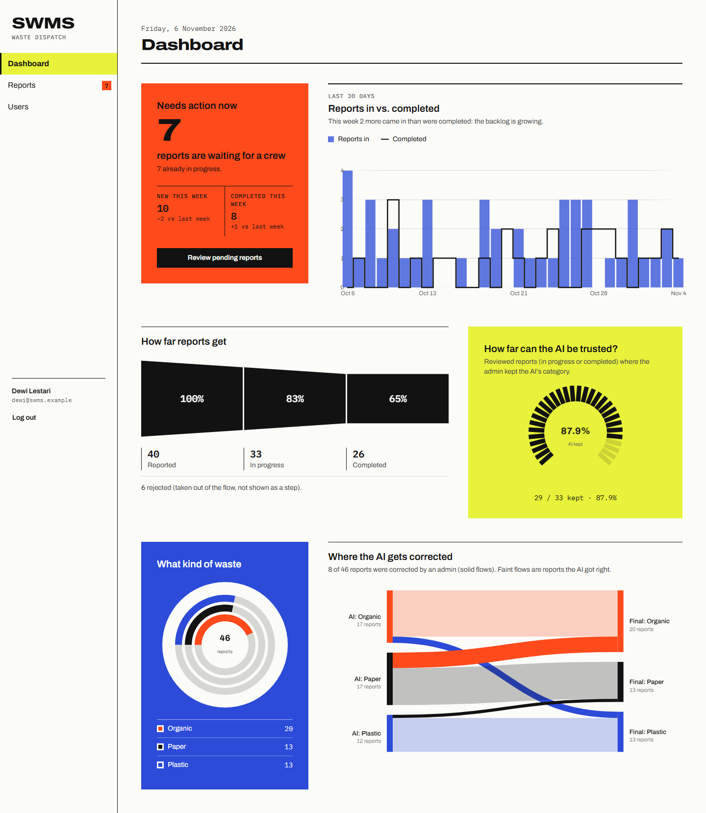
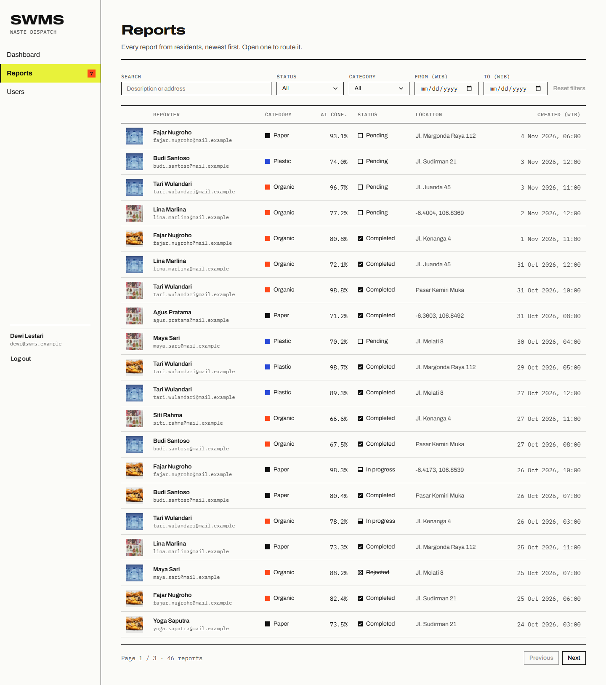
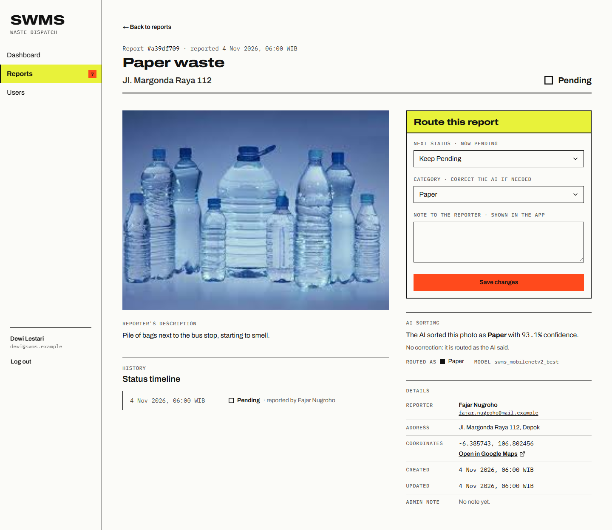

# Smart Waste Management System (SWMS)

Residents are the eyes, the AI is the sorter, admins are the dispatchers. A resident sees waste lying around,
takes a photo in the Android app, and the app adds the GPS location. The backend sends the photo to an image
classifier that sorts it into **organic**, **paper** or **plastic**, and the report lands in the admin web panel.
An admin checks the AI's category (correcting it if needed), routes the report through
`pending → in_progress → completed` (or `rejected` with a note), and the resident follows that status in the app.
The problem it addresses: waste reports that arrive unsorted, without a location and without feedback to the
person who reported them.

## Live demo

| | |
|---|---|
| Admin web panel | https://smart-waste-system-management.vercel.app |
| Android APK | [GitHub Releases → latest](https://github.com/jieffrey/Smart-Waste-System-Management/releases/latest) |
| Backend health | <!-- TODO(owner): replace with the real Railway domain --> `https://<backend>.up.railway.app/api/health` → `{"status":"ok"}` |

Demo credentials (one admin, one resident) are in the submission email. They are not in this repository.

The ML API has no public URL: only the backend can reach it, over Railway's private network.

## Screenshots

<!-- TODO(owner): these web screenshots (docs/screenshots/polish-final/, 2026-11-06 14:01) predate the
     Plus Jakarta Sans font, the glass top bar and the needs-review / possible-duplicate markers. Recapture them
     with tools/screenshots when convenient. -->

| Dashboard | Reports list | Report detail |
|---|---|---|
|  |  |  |

<!-- TODO(owner): add mobile screenshots. The only mobile captures (docs/screenshots/mobile/ and
     docs/screenshots/polish-final/mobile/) predate the glass tab bar, onboarding, handling guidance, the
     "Baru" update tag and the low-confidence message, so they are left out on purpose. Wanted:
     onboarding slide, AI result (with handling guidance), "Laporan saya" list (with a "Baru" tag). -->

## Features

### Resident (mobile app, Android; UI in Bahasa Indonesia)

- **Onboarding:** three animated slides on first launch, skippable (**Lewati**), replayable from settings.
- **Account:** register, log in, log out; the session is restored on start (token in `expo-secure-store`).
- **Email verification (OTP):** a 6-digit code screen with a resend countdown. Only active when the backend runs
  with `OTP_ENABLED=true` (off by default). In the live demo it is **TODO: on / off**.
  <!-- TODO(owner): fill in whether OTP_ENABLED is on in the deployed demo. -->
- **New report:** photo from camera or gallery (resized to 1600 px, JPEG), GPS location with an editable address,
  description. After submitting, the app shows the AI category and confidence.
- **Low-confidence message:** when the AI is unsure (see *needs review* below), the result says an officer will
  check it manually.
- **Handling guidance:** per category, what it is, how to handle it and where it can go (compost, waste bank,
  collector), on the AI result and the report detail.
- **Possible-duplicate note** after submitting, when a matching open report already exists nearby.
- **My reports:** status filter, pull to refresh, infinite scroll. Reports with an update the owner hasn't opened
  yet get a **Baru** ("new") tag, and the tab shows the count.
- **Report detail:** photo, status timeline with admin notes, AI category and confidence (and the AI's original
  guess if an admin corrected it), Open in Maps.
- **Account settings:** edit name and email, change password, replay the guide, log out.

### Admin (web panel)

- **Dashboard:** totals by status and category, reports and completions per day (30 days, Asia/Jakarta), AI
  accuracy on reviewed reports, a Sankey chart from AI category to current category, and the needs-review count.
- **Reports list:** filters for status, category, date range, text search, *needs review* and *possible
  duplicate*.
- **Report detail:** reporter, photo, location, AI result, status history with who changed what. Change status
  (only allowed transitions; a note is required to reject), correct the category (the original AI prediction is
  kept), add a note. Handling guidance for the category, and links between a report and its possible duplicates
  in both directions.
- **Users:** list and search users with their report count; activate or deactivate accounts (a deactivated
  user's token stops working at once; an admin can't deactivate their own account).
- **Settings:** edit profile, change password, log out.

### AI

- **Classification on upload:** every new report's photo is classified by the ML API before anything is stored.
  If the ML API is down, the report is not saved (`503`) and the app keeps the form filled in.
- **Needs review:** a report needs review when `ai_confidence < AI_REVIEW_THRESHOLD` (default `0.70`) and no
  admin has confirmed or corrected it yet (still `pending`, category unchanged). It is computed in SQL, not
  stored.
- **Possible duplicate:** on creation, the backend links a report to the nearest **open** report with the **same
  category**, created in the **last 24 hours**, within **50 m** (haversine). Nothing is blocked; the link is a hint
  for the admin.
- **AI accuracy:** the share of reviewed reports (`in_progress` / `completed`) whose category the admin left as
  the AI predicted it.
