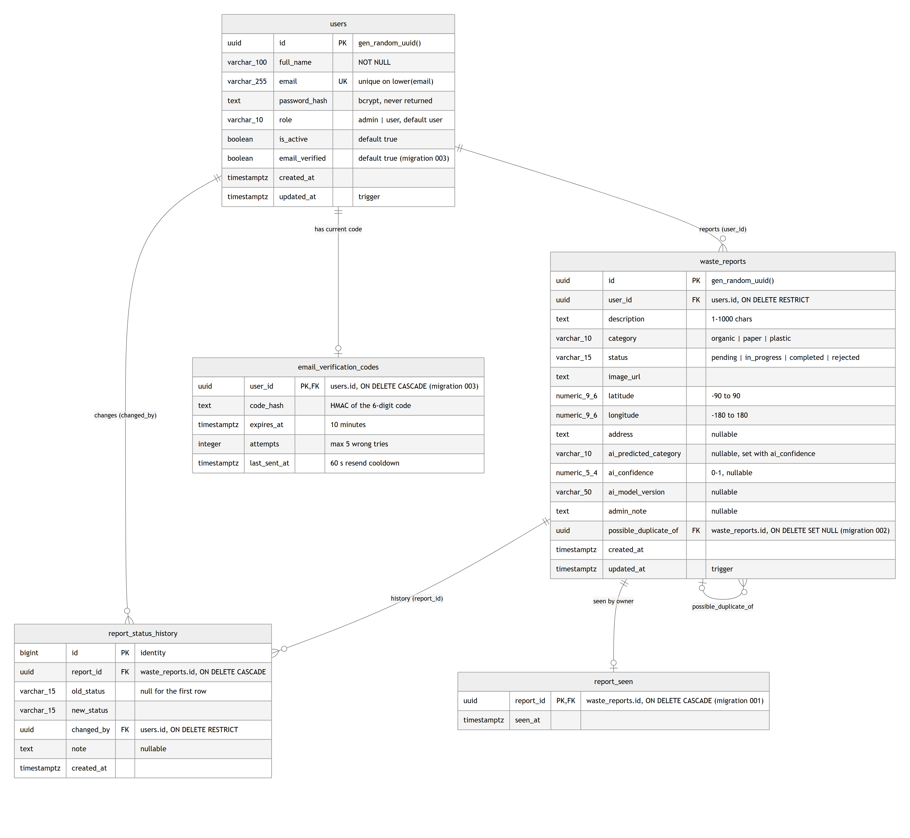
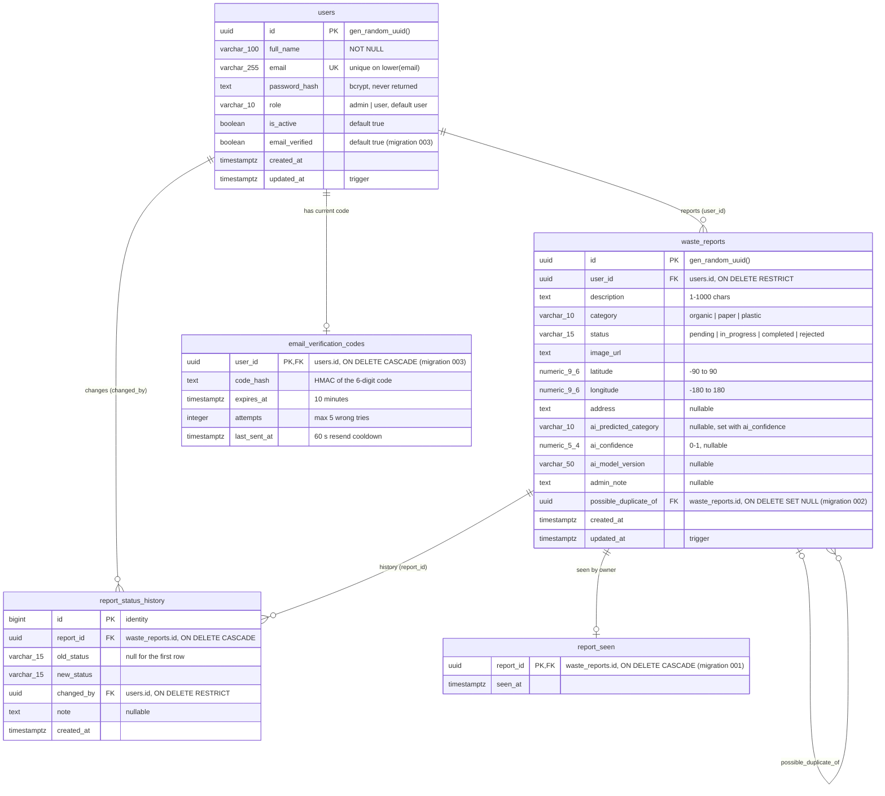

# SWMS database

PostgreSQL (Neon in production, PostgreSQL 18), raw parameterized SQL through `pg`, no ORM.

- Full schema for a new, empty database: [`backend/db/schema.sql`](../backend/db/schema.sql) (one transaction;
  already includes every migration).
- Changes to an existing database: the numbered files in [`backend/db/migrations/`](../backend/db/migrations/),
  run as described in [`docs/migrations-runbook.md`](migrations-runbook.md):
  [001 `report_seen`](../backend/db/migrations/001_report_seen.sql),
  [002 `possible_duplicate_of`](../backend/db/migrations/002_possible_duplicate.sql),
  [003 email verification](../backend/db/migrations/003_email_verification.sql).

## ERD



<details>
<summary>Mermaid source (also rendered by GitHub)</summary>



</details>

Types in the diagram use `_` for parentheses (Mermaid doesn't allow them): `varchar_100` = `varchar(100)`,
`numeric_9_6` = `numeric(9,6)`, `timestamptz` = `timestamp with time zone`.

## Tables

| Table | What it holds |
|---|---|
| `users` | Residents (`role = 'user'`) and admins. Public registration only creates `user`; the first admin comes from the seed script. `is_active = false` blocks every request at once. `email_verified` is `false` only for accounts registered with `OTP_ENABLED=true` that haven't entered their code yet. |
| `waste_reports` | One report: the photo URL, location, description, the current `category` and `status`, the AI's own result (`ai_predicted_category`, `ai_confidence`, `ai_model_version`, never changed by an admin), the admin's note, and an optional link to an earlier report it may duplicate. |
| `report_status_history` | One row per status change, oldest first: the first row (`old_status` null → `pending`) is written with the report, every later one by the admin who changed it (`changed_by`, `note`), in the same transaction as the update. |
| `report_seen` | When the report's owner last opened it. A report "has an update" for its owner when `updated_at > COALESCE(seen_at, created_at)`; that drives the "Baru" tag and the tab count in the app. |
| `email_verification_codes` | The current code of an unverified account: only an HMAC of it, the expiry, the number of wrong tries and when it was last sent. One row per user at most. |

**Self-reference.** `waste_reports.possible_duplicate_of` points at an earlier report with the same category that
was still open (`pending` / `in_progress`), within 50 m and 24 hours, when the new report was created. It is a hint
for the admin, not a block. Deleting the earlier report sets the link to `NULL`.

**Derived, not stored:** `needs_review` (AI confidence below `AI_REVIEW_THRESHOLD`, still `pending`, category
unchanged) and `has_update` are computed in SQL on every read, so they never go stale.

## Rules enforced by the database

- `CHECK` constraints on every enum-like column (role, category, status, AI category), on coordinates, on
  `ai_confidence` (0–1), and on the description length (1–1000 after trimming).
- `waste_reports_ai_result_complete`: `ai_predicted_category` and `ai_confidence` are both set or both `NULL`.
- Emails are unique regardless of letter case (`users_email_lower_uq` on `lower(email)`).
- `ON DELETE RESTRICT` from reports and history to `users`, so a user with reports or history rows can't be deleted
  by accident (accounts are deactivated instead). History, `report_seen` and verification codes are removed with
  their report / user (`CASCADE`).
- A `BEFORE UPDATE` trigger (`set_updated_at()`) keeps `updated_at` current on `users` and `waste_reports`.

## Status transitions (enforced by the backend)

```
pending      → in_progress | rejected
in_progress  → completed   | rejected
completed, rejected → final (no more changes of any kind)
```

The backend checks these in `PATCH /api/admin/reports/:id` with the row locked (`SELECT … FOR UPDATE`), and a
rejection needs a note. The database only checks that each status value is valid. See
[`docs/API.md`](API.md#patch-apiadminreportsid).

## Indexes

| Index | On | Used by |
|---|---|---|
| `users_email_lower_uq` (unique) | `users (lower(email))` | Login, registration, uniqueness regardless of case |
| `waste_reports_user_created_idx` | `waste_reports (user_id, created_at DESC)` | A resident's own reports, newest first |
| `waste_reports_status_created_idx` | `waste_reports (status, created_at DESC)` | Lists and counts filtered by status, newest first |
| `waste_reports_category_idx` | `waste_reports (category)` | Category filter and stats |
| `waste_reports_possible_duplicate_of_idx` (partial, `WHERE possible_duplicate_of IS NOT NULL`) | `waste_reports (possible_duplicate_of)` | The duplicate filter and the "later duplicates" list on a report |
| `report_status_history_report_idx` | `report_status_history (report_id, created_at)` | A report's timeline |

Primary keys (`users.id`, `waste_reports.id`, `report_status_history.id`, `report_seen.report_id`,
`email_verification_codes.user_id`) are indexed automatically.
