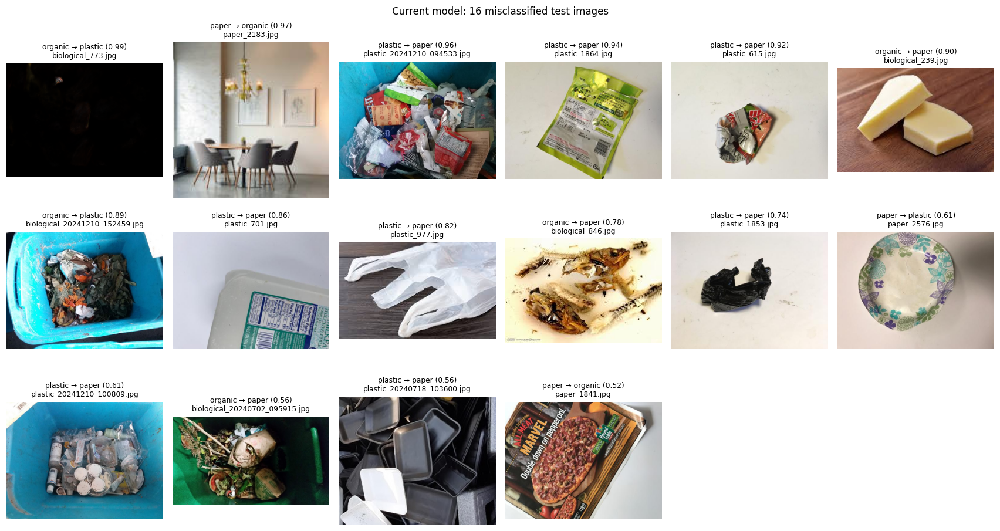
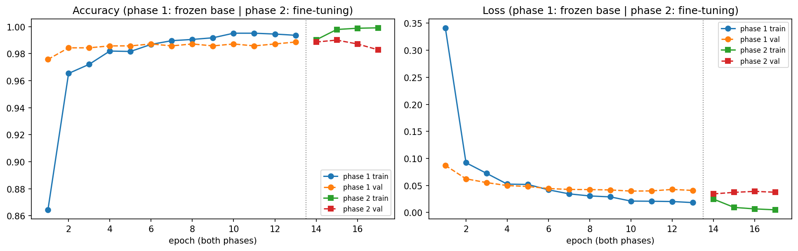
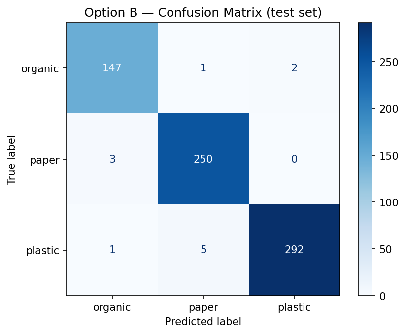
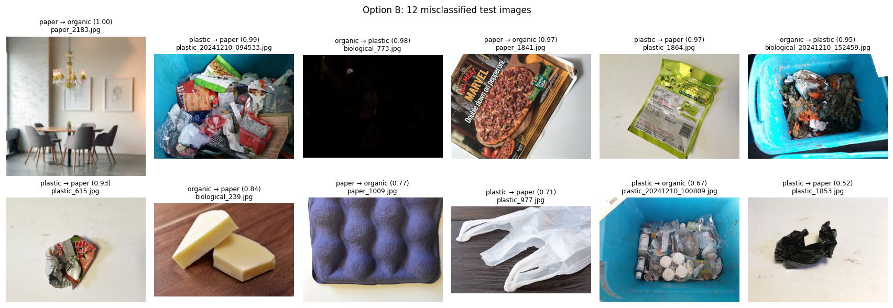

# SWMS ML — Waste Image Classifier API

FastAPI service that classifies a waste photo as **organic**, **paper** or **plastic** using a
MobileNetV2 transfer-learning model. The Express backend calls this service; it is not meant to be
exposed publicly.

## Model

| | |
|---|---|
| Architecture | MobileNetV2 (transfer learning) |
| Served model | **Option B**: class weights + fine-tuning the top of MobileNetV2 ([section 10](#10-option-b-class-weights--fine-tuning-the-served-model)) |
| File | `models/swms_mobilenetv2_option_b.keras` (Keras 3.13.2); exported copy `models/swms_mobilenetv2_option_b.onnx` for production ([Serving runtimes](#serving-runtimes-ml_runtime)) |
| `model_version` | `swms_mobilenetv2_option_b` |
| Input | 224×224 RGB |
| Classes (in order) | `organic`, `paper`, `plastic` |
| Test accuracy | **98.29%** (689 of 701; the first model, kept as the baseline, had 97.72%) |
| Test loss | **0.0611** (baseline 0.0800) |

**Dataset:** the training data and the 3 sample images in `tests/samples/` (taken from the test split)
come from the Kaggle [Garbage Classification V2](https://www.kaggle.com/datasets/sumn2u/garbage-classification-v2)
dataset by sumn2u (version 8, MIT license). Its `biological` class is used as **organic**. See
[ML Development Process](#ml-development-process).

**Preprocessing is inside the model.** The model already contains MobileNetV2's preprocessing
(`x / 127.5 − 1`), so the API sends **raw 0–255 RGB pixels**. Do not divide by 255 or call
`preprocess_input` — that would apply it twice and give wrong predictions.

The API resizes images the same way as training (`image_dataset_from_directory`):
`tf.image.resize` to 224×224, bilinear, no antialias, no crop (the lite runtime uses an exact NumPy copy of it). It additionally applies EXIF
rotation so phone photos are upright (training did not): decode with Pillow → EXIF rotation →
RGB → float32 → resize.

## Setup

Requires [uv](https://docs.astral.sh/uv/). TensorFlow needs Python 3.12 (it does not support 3.14).
Run from the `ml/` folder:

```bash
uv venv .venv --python 3.12
uv pip install -r requirements-dev.txt
```

| File | What it's for |
|---|---|
| `requirements.txt` | API with the TensorFlow runtime (`ML_RUNTIME=tf`, the local default) |
| `requirements-lite.txt` | API with the lite runtime, **no TensorFlow** (`ML_RUNTIME=lite`, production / Docker) |
| `requirements-export.txt` | `requirements.txt` + ONNX export tools (`scripts/export_lite.py`) |
| `requirements-dev.txt` | everything above + `pytest`, `httpx`: the tests check both runtimes |
| `requirements-train.txt` | training/evaluation scripts (Colab versions; separate environment) |

## Run the API

From `ml/`:

```bash
# Windows
.venv\Scripts\python -m uvicorn src.api.main:app --port 8000

# macOS / Linux
.venv/bin/python -m uvicorn src.api.main:app --port 8000
```

(Or activate the venv first and run `uvicorn src.api.main:app --port 8000`.)
Interactive docs: http://localhost:8000/docs (removed when `ML_DISABLE_DOCS=1`, as in the Docker image).

| Env var | Default | Meaning |
|---|---|---|
| `ML_RUNTIME` | `tf` | `tf` = `.keras` with TensorFlow; `lite` = `.onnx` with ONNX Runtime ([Serving runtimes](#serving-runtimes-ml_runtime)) |
| `MODEL_PATH` | `models/swms_mobilenetv2_option_b.keras` / `.onnx` | Model file; its name (without extension) is the `model_version` |
| `ML_API_KEY` | *(unset)* | When set, `/predict` requires header `X-API-Key` with this value (constant-time compare) → otherwise `401`. `/health` stays open |
| `ML_DISABLE_DOCS` | *(unset)* | `1` removes `/docs`, `/redoc`, `/openapi.json` |
| `PORT` | `8000` | Port for `python -m src.api.serve` (Docker) |

## Serving runtimes (`ML_RUNTIME`)

Training, evaluation and the Colab parity values stay **TensorFlow/Keras**. For production the same model is
exported to ONNX and served with **ONNX Runtime**, so the always-on container doesn't load TensorFlow.

```bash
python -m scripts.export_lite                       # the served model: models/swms_mobilenetv2_option_b.keras → .onnx (+ .onnx.json)
python -m scripts.export_lite --model models/swms_mobilenetv2_best.keras       # any other .keras file, e.g. the baseline
python -m scripts.export_lite --dataset <folder>    # also check every image in a folder
```

The export is only written if the ONNX model matches Keras through the whole API pipeline. That means every
class probability within **0.01** (the parity-test tolerance) and **no label flips**, on random inputs, the 3
samples and, with `--dataset`, every image in the folder. The result is recorded in `models/*.onnx.json`.

**Measured** (2026-11-05, Linux container `python:3.12-slim`, with the first model. Re-measured with the served
Option B model on 2026-11-06 in the production image: 118 MB after startup, 143 MB after 20 predictions, image
444 MB, i.e. the same. Option B's own parity numbers are in
[section 10](#10-option-b-class-weights--fine-tuning-the-served-model)):

| | `tf` (TensorFlow 2.21) | `lite`: ONNX Runtime 1.31 (**chosen**) | LiteRT 2.3 (evaluated) |
|---|---|---|---|
| Parity on all **4,661** dataset images of the 3 classes (a superset of the test split) | reference | max \|Δp\| **1.5e-5**, **0** label flips | max \|Δp\| 2.0e-5, 0 label flips |
| Parity on the 3 samples vs `expected.json` | ✓ | ✓ (test `test_lite_runtime.py`) | ✓ |
| RSS after startup | 595 MB | **118 MB** | 98 MB |
| RSS after 20 predictions | 708 MB | **143 MB** | 104 MB |
| Peak for one 24 MP (6000×4000) upload | — | 660 MB, back to 156 MB after | — |
| Docker image (uncompressed) | 3.14 GB | **444 MB** | 483 MB |
| Model file | 9.7 MB | 8.9 MB | 8.9 MB |

The 3 samples aren't part of the parity set: the Colab split can't be rebuilt exactly here (file order), so all
images of the 3 classes were used instead. That includes every test image, whichever files they are.

**Why ONNX Runtime and not LiteRT.** Both match Keras equally well, and LiteRT uses about 30 MB less RAM (about
$0.30/month on Railway). ONNX was chosen because its export path is the more reliable one on this stack:
- **Export:** Keras 3.13's built-in `model.export(format="onnx")` (tf2onnx under the hood) worked first time. LiteRT
  conversion depends on TensorFlow's `tf.lite` converter, which TF marks as deprecated and scheduled for removal.
  One of its standard routes (`TFLiteConverter.from_concrete_functions`) produced a broken 200 KB model that output
  NaN without any error.
- **Runtime:** ONNX Runtime is a mature, widely used runtime with a stable API, independent of TensorFlow's release
  cycle. That matters when Option B (or a model trained with a newer TF) is exported later.

The export script still guards against a bad export: it refuses to write a model that doesn't match.

**Resize without TensorFlow:** `src/inference/resize.py` re-implements `tf.image.resize` (bilinear, half-pixel
centres, no antialias) in NumPy. It is identical to TensorFlow on 117 real photos and on random shapes (max
difference 0.0), and `tests/test_resize.py` checks it against TensorFlow.

## Docker (Railway)

`Dockerfile` builds the production image: `python:3.12-slim` + `requirements-lite.txt`, the API code and the
exported `.onnx` model (allowlisted in `.dockerignore`). It runs as a non-root user with `ML_RUNTIME=lite` and
`ML_DISABLE_DOCS=1`, and starts with `python -m src.api.serve`. That opens **one dual-stack socket** (IPv4 + IPv6)
on `$PORT`. `uvicorn --host ::` alone would be IPv6-only, which breaks IPv4 callers on Railway's private
network. `railway.json` sets the healthcheck (`/health`) and the restart policy.

```bash
docker build -t swms-ml .
docker run --rm -p 8000:8000 -e ML_API_KEY=change-me swms-ml
```

## Run the tests

From `ml/`:

```bash
.venv\Scripts\python -m pytest        # Windows
.venv/bin/python -m pytest            # macOS / Linux
```

The Colab comparison test checks every image listed in `tests/samples/expected.json`
(see `tests/samples/README.md`) and is skipped if that file is missing.

## Endpoints

### `GET /health`

```bash
curl http://localhost:8000/health
```

```json
{ "status": "ok", "model_loaded": true, "model_version": "swms_mobilenetv2_option_b", "runtime": "tf" }
```

### `POST /predict`

Send the image as `multipart/form-data` in a field named `file`.
Accepted: **JPEG, PNG, WebP**, up to **5 MB** and **24 million pixels** (about 6000 × 4000). The type is
checked by decoding the image, not by trusting the file name or content type.

Limits are checked as early as possible, so a hostile upload costs little:

- **Body size:** a request body over 5 MB (plus room for the multipart headers) is refused with `413`
  from its `Content-Length` before any of it is read. A chunked upload without `Content-Length` is
  stopped as soon as it passes the limit.
- **Dimensions:** the width and height are read from the image header and checked *before* decoding,
  so a small file that claims huge dimensions (a "decompression bomb") is refused with `400`. Pillow's
  own protection (`Image.MAX_IMAGE_PIXELS`) is set to the same limit as a backstop.
- **Broken files:** truncated, corrupt or non-image files get a `400`/`415`, never a `500`.

```bash
curl -F "file=@tests/samples/plastic_101.jpg" http://localhost:8000/predict
```

```json
{
  "category": "plastic",
  "confidence": 0.9999,
  "probabilities": { "organic": 0.0, "paper": 0.0001, "plastic": 0.9999 },
  "model_version": "swms_mobilenetv2_option_b"
}
```

`confidence` is the probability of the predicted `category`. Values are rounded to 4 decimals
(matching the database column `ai_confidence NUMERIC(5,4)`).

### Errors

All errors use the same format as the Express backend:

```json
{ "error": { "message": "Validation failed", "details": [{ "field": "file", "message": "Field required" }] } }
```

| Status | When |
|---|---|
| `400` | No `file` field, empty file, corrupt/truncated image, or image dimensions too large |
| `401` | `ML_API_KEY` is set and `X-API-Key` is missing or wrong (checked before the body is read) |
| `413` | Request body (file) larger than 5 MB |
| `415` | Not a JPEG, PNG or WebP image (e.g. a text file or GIF) |
| `404` / `405` | Unknown route or wrong HTTP method |
| `500` | Unexpected server error (no internal details are returned) |

## ML Development Process

How the classifier was built, what the numbers mean, and where it falls short. **Every number in this
section comes from a file in this repository**: the notebook outputs
([`notebooks/garbage_classification.ipynb`](notebooks/garbage_classification.ipynb),
[`notebooks/train_option_b.ipynb`](notebooks/train_option_b.ipynb)), the files in [`results/`](results/),
the split script, or the test samples. Numbers marked *computed* are simple arithmetic on those values. When a
number isn't available, the text says so instead of estimating it.

**Two models.** Sections 1–9 describe the **first model** (`swms_mobilenetv2_best`, frozen base, 3 epochs). It is
kept in `models/` as the **baseline**. [Section 10](#10-option-b-class-weights--fine-tuning-the-served-model)
describes **Option B** (`swms_mobilenetv2_option_b`), which is the **served model** since it met the comparison
criteria set before its results were known. Both were evaluated on the same 701-image test set.

### 1. Problem & dataset

**Task:** given one photo of waste, predict one of three classes: `organic`, `paper` or `plastic`. The
prediction is used as the report's starting category, and an admin can correct it.

**Source:** Kaggle [Garbage Classification V2](https://www.kaggle.com/datasets/sumn2u/garbage-classification-v2)
by sumn2u, **version 8**, downloaded with the Kaggle API in Colab, licensed **MIT** (as labelled on its Kaggle
page). Only three of its class folders are used: `biological` (renamed to `organic`), `paper` and `plastic`. The
training images are not committed (`ml/dataset/` is gitignored). The three images in `tests/samples/` come from the
test split, and so do the 48 resized, metadata-free demo photos in
[`backend/scripts/demo/photos/`](../backend/scripts/demo/photos/) (with an
[attribution and the MIT text](../backend/scripts/demo/photos/ATTRIBUTION.md)).

**Size:** 4,661 images, and all 4,661 opened without errors (the notebook checks every file with Pillow:
0 broken files per class).

| Class | Train | Validation | Test | Total | Share of all images (*computed*) |
|---|---|---|---|---|---|
| `organic` | 697 | 150 | 150 | 997 | 21.4% |
| `paper` | 1,175 | 252 | 253 | 1,680 | 36.0% |
| `plastic` | 1,388 | 298 | 298 | 1,984 | 42.6% |
| **Total** | **3,260** | **700** | **701** | **4,661** | 100% |

**How the split was made:** [`scripts/split_dataset.py`](scripts/split_dataset.py) (the notebook's code).
**Each class is split on its own** with scikit-learn's `train_test_split`, `shuffle=True`, `random_state=42`:
first 70% train / 30% rest, then the rest 50/50 into validation and test. Because every class is split
separately, each split keeps the same class proportions: the split is **stratified by construction**,
although the `stratify=` argument isn't used. *Computed*, `organic` is 21.4% of train, 21.4% of validation
and 21.4% of test.

Two caveats:
- The script lists files with `os.listdir`, whose order depends on the file system. The **counts** per split
  are always the same, but on another machine *which* files land in which split can differ.
- The dataset was **not checked for duplicates or near-duplicates** across splits. If it has them, test
  results could be optimistic. Not measured.

### 2. Why transfer learning with MobileNetV2

- **The dataset is small for training a CNN from scratch.** 3,260 training images, of which only 697 are
  `organic`. A convolutional network trained from random weights on that much data would mostly
  memorise the training images. Transfer learning reuses features (edges, textures, shapes)
  that MobileNetV2 already learned on ImageNet, so only a small new head has to learn from our data.
- **Few parameters to learn.** With the base frozen, the model has **3,843 trainable** parameters out of
  **2,261,827** (notebook `model.summary()`), which is one reason a few epochs could already reach the results below.
- **Small and fast to serve.** The saved model is **9,667,404 bytes** (`models/swms_mobilenetv2_best.keras`,
  about 9.7 MB, *computed*). MobileNetV2 was designed for mobile and embedded devices, which suits a
  classification API running on CPU behind the backend. Inference latency was **not measured**.
- **Alternatives considered, not trained:**
  - **Training from scratch** was ruled out for the data-size reason above.
  - **Larger backbones** (for example ResNet or bigger EfficientNet variants) would make the model file
    and the CPU inference heavier for a 3-class problem the small model already handles well.

  **No comparison runs were done** for either option, so there are no numbers for them in this
  repository. This choice is a reasoned starting point, not a measured winner.

### 3. Preprocessing

**Training** (`tf.keras.utils.image_dataset_from_directory`):
- Images are decoded by TensorFlow and resized to **224×224** with `tf.image.resize` (bilinear, no
  antialias, no crop; the aspect ratio is not kept).
- **Normalization is part of the model:** the first layers are MobileNetV2's `preprocess_input`
  (`x / 127.5 − 1`, scaling pixels to [-1, 1]; visible as the `TrueDivide` and `Subtract` layers in the
  model summary). The model therefore takes **raw 0–255 pixels**.
- **No data augmentation** was used: the final training run has no flip, rotation, zoom or colour layers.
  There was nothing to restrict to the training set. Augmentation is a candidate for
  [Next steps](#10-next-steps).

**API** ([`src/inference/predictor.py`](src/inference/predictor.py)): decode with Pillow → apply the EXIF
rotation (so phone photos are upright; training did not do this) → RGB → `float32` → `tf.image.resize` to
224×224 (bilinear, `antialias=False`) → model. The pixels are **not** divided by 255 and `preprocess_input`
is **not** called again: doing either would apply the normalization twice and give wrong predictions.

**How parity between training and the API was proven.** Training decodes with TensorFlow and the API
decodes with Pillow, so they could differ in small ways. To check:
1. Notebook cell 28 ran the trained model in Colab on three test-split images, using `tf.io.decode_image` +
   `tf.image.resize`, and printed the probabilities.
2. Those values are stored in [`tests/samples/expected.json`](tests/samples/expected.json), next to the
   images.
3. `test_predict_matches_colab` sends each image through the real `/predict` endpoint and requires the same
   class and every probability within ±0.01.

The measured differences are far smaller than that tolerance. API output versus Colab, re-measured for
this document:

| Image | Class (both) | Largest difference, first model | Largest difference, Option B (served) |
|---|---|---|---|
| `biological_102.jpg` | `organic` | 0.0000 | 0.0000 |
| `paper_1000.jpg` | `paper` | 0.0001 | 0.0000 |
| `plastic_101.jpg` | `plastic` | 0.0002 | 0.0001 |

So the API reproduces the training-time predictions to within **0.0002**. `expected.json` now holds the Option B
values (from `results/option_b/metrics/expected_option_b.json`, same Colab method). Only three images are checked;
the test guards against a broken pipeline (for example normalizing twice), not against every possible decoder
difference.

### 4. Training setup

Exactly as in the final notebook run (cells 19–23) and [`src/training/train.py`](src/training/train.py):

| Setting | Value |
|---|---|
| Base | MobileNetV2, ImageNet weights, `include_top=False`, **frozen** (`trainable = False`, called with `training=False`, so BatchNorm stays in inference mode) |
| Head | `GlobalAveragePooling2D` → `Dropout(0.2)` → `Dense(3, softmax)` |
| Parameters | 3,843 trainable / 2,257,984 frozen / 2,261,827 total |
| Loss | `sparse_categorical_crossentropy` (integer labels) |
| Optimizer | Adam, learning rate **0.001** |
| Batch size | **32** (102 steps per epoch in the training log) |
| Epochs | **3** |
| Callbacks | `ModelCheckpoint(monitor="val_loss", save_best_only=True)` and `EarlyStopping(monitor="val_loss", patience=2, restore_best_weights=True)` |
| Seeds | `seed=42` for shuffling the training set; **no global seed**, so a rerun is not bit-for-bit identical |
| Environment | Google Colab, GPU T4, Python 3.13.16 (recorded in `requirements-train.txt`); TensorFlow 2.21.0 (printed in the notebook); the API runs the saved model on Python 3.12 with the same TensorFlow 2.21.0 and Keras 3.13.2 |

Per-epoch history ([`results/metrics/training_history.csv`](results/metrics/training_history.csv)):

| Epoch | Train accuracy | Train loss | Val accuracy | Val loss |
|---|---|---|---|---|
| 1 | 0.8899 | 0.2797 | 0.9757 | 0.0903 |
| 2 | 0.9678 | 0.0949 | 0.9743 | 0.0743 |
| 3 | 0.9801 | 0.0676 | 0.9857 | 0.0645 |

What this shows:
- **Validation loss improved every epoch, so early stopping never fired.** Training ended at the 3-epoch
  limit, and the checkpoint kept epoch 3. The model may not be fully converged; more epochs are an open
  question for [Next steps](#10-next-steps).
- In epoch 1, validation accuracy (0.9757) is higher than training accuracy (0.8899). That is normal here:
  training accuracy is averaged over the epoch while the head is still learning, and dropout is active
  only during training.

**An earlier run was abandoned** (notebook cell 15, not in the scripts): 5 epochs, no callbacks. The
log shows two finished epochs (validation accuracy 0.9771 then 0.9829, validation loss 0.0861 then 0.0676)
before epoch 3 started. The next cells report that `history` and `model` no longer existed (the Colab
session state was lost), and training was re-run with checkpointing. The notebook doesn't record **why
3 epochs** were chosen for the final run.


### 5. Results

On the **701 test images**: accuracy **97.72%** (685 correct, 16 wrong) and loss **0.0800**
([`results/metrics/test_metrics.json`](results/metrics/test_metrics.json); the notebook prints 97.7175%).

Per class ([`results/metrics/classification_report.json`](results/metrics/classification_report.json)):

| Class | Precision | Recall | F1-score | Support |
|---|---|---|---|---|
| `organic` | 0.9864 | 0.9667 | 0.9764 | 150 |
| `paper` | 0.9579 | 0.9881 | 0.9728 | 253 |
| `plastic` | 0.9898 | 0.9732 | 0.9814 | 298 |
| macro avg | 0.9780 | 0.9760 | 0.9769 | 701 |
| weighted avg | 0.9775 | 0.9772 | 0.9772 | 701 |

Confusion matrix ([`results/metrics/confusion_matrix.csv`](results/metrics/confusion_matrix.csv); rows are the
true class, columns the prediction):

| True \ Predicted | `organic` | `paper` | `plastic` |
|---|---|---|---|
| `organic` | **145** | 3 | 2 |
| `paper` | 2 | **250** | 1 |
| `plastic` | 0 | 8 | **290** |


The training curves are in [section 4](#4-training-setup).

**Was the test set used for model selection?** As far as the notebook records, **no**:
- The saved epoch was picked by the checkpoint on **validation** loss.
- The test set was only evaluated afterwards, on that saved model. The notebook evaluates it several times
  (cells 24, 25, 27 and 30, while writing the result files), always the same model with the same 97.72%, and
  nothing was changed or retrained after seeing a test result.
- The 3-epoch setting was chosen after the abandoned first run, whose only visible results were training
  and **validation** numbers.
- The three images in `tests/samples/` come from the test split, but they are only used to check
  API-versus-Colab parity, not to choose anything.

### 6. Class imbalance

The classes are not balanced (see the table in [section 1](#1-problem--dataset)): `plastic` has 1,984 images
and `organic` only 997, about **2.0×** fewer (*computed*: 1,984 / 997 = 1.99). The training set has the
same ratio: 1,388 `plastic` and 697 `organic`.

**Why this matters for overall accuracy.** Accuracy counts every test image equally, so the big classes
dominate it. A useless model that always answered `plastic` would already score **42.5%** on this test
set (*computed*: 298 / 701). A real model can look good overall while doing worse on the small class.

**The fairer view is per-class recall:** of the images that really are class X, how many did the model
find?

| Class | Test images | Found (recall) | Missed |
|---|---|---|---|
| `organic` | 150 | 145 (0.9667) | 5 |
| `paper` | 253 | 250 (0.9881) | 3 |
| `plastic` | 298 | 290 (0.9732) | 8 |

- **The smallest class has the lowest recall.** `organic` is 0.9667, against 0.9772 overall accuracy. That
  fits what imbalance tends to cause, but with 150 test images (5 misses) it isn't proof of it.
- **Macro-averaged recall** (each class counts equally) is **0.9760**, very close to the 0.9772 accuracy, so
  on this test set the imbalance distorts the headline number only a little.
- **Precision shows the other side:** `paper` has the lowest precision (0.9579). Of the 261 images
  predicted as `paper` (*computed* from the confusion matrix), 11 were wrong: 8 `plastic` and 3 `organic`.

**What was done about it: nothing yet.** The assessment brief suggests addressing class balance. The final
model uses no class weights, no oversampling and no augmentation. This is planned work
([Next steps](#10-next-steps)).

### 7. Error analysis

The 16 test errors, from the confusion matrix:

| True → predicted | Count |
|---|---|
| `plastic` → `paper` | **8** |
| `organic` → `paper` | 3 |
| `organic` → `plastic` | 2 |
| `paper` → `organic` | 2 |
| `paper` → `plastic` | 1 |
| `plastic` → `organic` | 0 |

**The main confusion is `plastic` predicted as `paper`:** 8 of 298 plastic test images (2.7%, *computed*),
half of all errors. `paper` is also the class the model over-predicts most (11 of its 16 errors are
predictions of `paper`).

**What the misclassified images have in common.** The Option B notebook re-evaluated this model on the same test
set (it reproduced the confusion matrix above exactly) and saved all 16 errors as a grid
([`results/option_b/current_model/figures/misclassified.png`](results/option_b/current_model/figures/misclassified.png),
file list in [`misclassified.csv`](results/option_b/current_model/metrics/misclassified.csv)):



What the grid shows (my reading of 16 images, so a description, not a statistic):
- **Printed plastic packaging read as paper** (the main `plastic` → `paper` confusion): a printed snack pouch,
  a crumpled printed wrapper, a bin full of printed food packaging, and a bottle label filling most of the frame.
- **Thin or flat plastic:** a white plastic bag and a black bag (`plastic` → `paper`), and black food trays.
- **Mixed bins:** two photos of a blue bin with several materials. A single label is debatable for these
  ([Limitations](#8-limitations)).
- **Printed food imagery:** a pizza box with a big photo of pizza is predicted `organic`.
- **Data quality, not model errors:** `biological_773.jpg` is almost completely black, and `paper_2183.jpg` shows
  a dining room with no visible waste. No model can be "right" on these. They are label/data problems in the
  dataset, and they count as errors for both models.

The earlier hypothesis about backgrounds can't be confirmed or ruled out from 16 images.

### 8. Limitations

- **No "not waste / unknown" class.** The model must pick one of three labels for *any* image: a selfie, a
  street sign or a glass bottle still comes back as `organic`, `paper` or `plastic`, and nothing in the output
  says "this isn't waste". The admin review step is the safeguard.
- **One label per photo.** Every training image has exactly one label. A photo with several materials (a mixed
  pile) still gets a single answer, and the model can't say "this is mixed".
- **Dataset photos are not street photos.** The Kaggle images differ from real reports in lighting,
  background, distance and clutter. Accuracy on real phone photos from the app has **not been measured**;
  the 98.29% (Option B) only holds for images like the test split.
- **Phone photo pipeline.** The mobile app shrinks photos to at most 1600 px and JPEG-compresses them before
  upload, and the API applies EXIF rotation, which training didn't. The parity test shows the API matches
  Colab on dataset images, but the effect of the phone pipeline on accuracy is untested.
- **Confidence is not a calibrated probability.** `confidence` is the softmax output of the top class. A value
  of 0.95 doesn't mean "right 95% of the time". Calibration was **not measured** (no reliability curve or
  ECE). Treat it as a ranking signal, not a guarantee.
- **Only three materials.** The dataset's other class folders were not used, so items of any other material are
  forced into one of the three classes.
- **Not checked:** duplicates across splits ([section 1](#1-problem--dataset)), and run-to-run variance (each
  model is a single training run; Option B set global seeds, but GPU kernels aren't deterministic and it wasn't
  re-run).

### 9. Serving

**FastAPI** ([`src/api/main.py`](src/api/main.py)), loaded once at startup:
- **`GET /health`:** `{ status, model_loaded, model_version, runtime }`.
- **`POST /predict`:** multipart field `file` → `{ category, confidence, probabilities, model_version }`
  ([details](#post-predict)).

**Input limits** (added in the security fixes, see [`docs/security-audit.md`](../docs/security-audit.md)
SEC-03 and SEC-08):
- **Body size:** a body over 5 MB is refused with `413` from its `Content-Length` **before it's read**,
  and a chunked upload is cut off as soon as it passes the limit.
- **Dimensions:** read from the image header and refused above **24 million pixels** **before decoding**.
  Pillow's own `MAX_IMAGE_PIXELS` is set to the same limit as a backstop. This stops "decompression bomb"
  images, where a small file claims huge dimensions.
- **Format:** only JPEG, PNG and WebP, detected by decoding, not by file name.
- **Broken files:** truncated or corrupt files get `400`/`415`, never `500`.
- **API key (SEC-09):** with `ML_API_KEY` set, `/predict` needs a matching `X-API-Key` header (constant-time
  compare, checked before the body is read); `/health` stays open. In production the service also has no
  public domain: only the backend reaches it, over Railway's private network.
- **Runtime:** production runs the exported ONNX model with ONNX Runtime ([Serving runtimes](#serving-runtimes-ml_runtime)).

**How the backend uses a prediction** (Express, `backend/src/modules/ml/ml.service.js` and
`reports.service.js`):
1. **Classify before saving.** When a user submits a report, the backend calls `/predict` *before* saving
   anything. If the ML API rejects the photo, the user gets `422` "The photo couldn't be processed" on the
   image field. If the ML API is down or too slow, they get `503` and nothing is saved.
2. **Set the category automatically.** The report's `category` is set from the prediction, and
   `ai_predicted_category`, `ai_confidence` and `ai_model_version` are stored next to it. Users can't choose
   the category.
3. **Let an admin correct it.** An admin can change `category` in the web panel. The AI fields are never
   edited, so the original prediction stays visible ("AI predicted X, corrected to Y").
4. **Measure accuracy on real reports.** The dashboard's **AI accuracy** is the share of *reviewed* reports
   (status `in_progress` or `completed`, with a prediction) whose final category still equals the AI
   prediction. Over time this measures the model on real app photos, which the test set can't do.

### 10. Option B: class weights + fine-tuning (the served model)

The plan and the comparison rules were written down **before** training ([notebook](notebooks/train_option_b.ipynb),
script [`src/training/train_option_b.py`](src/training/train_option_b.py)). All numbers below are from
[`results/option_b/`](results/option_b/).

**What was trained** (Colab, Tesla T4, TensorFlow 2.21.0 / Keras 3.13.2; [`run_config.json`](results/option_b/run_config.json)):

| | |
|---|---|
| Data and preprocessing | Same `dataset_split/` folder and the same loading/model code as the first model (`train.load_datasets`, `train.build_model`, preprocessing inside the model) |
| Seeds | Python, NumPy, TensorFlow and `PYTHONHASHSEED` = 42 (GPU kernels still not deterministic) |
| Class weights (train split only, `total / (classes × count)`) | `organic` 1.559, `paper` 0.925, `plastic` 0.783 |
| Phase 1: frozen base | Adam 1e-3, up to 20 epochs, EarlyStopping(val_loss, patience 3). Ran 13 epochs, **best epoch 10**, val_loss 0.0395 |
| Phase 2: fine-tuning | Unfrozen from `block_13_expand` (top 38 of 154 base layers, MobileNetV2's last stage); the 13 BatchNorm layers stayed frozen; 1,667,203 trainable parameters; Adam 1e-5. Ran 4 epochs, **best epoch 1**, val_loss 0.0343 |
| Selection | Lowest **validation** loss → phase 2, epoch 1. The test set was evaluated once, afterwards |

**Was the comparison fair?** Same split: the notebook re-evaluated the first model on the same test set and got
exactly the documented confusion matrix ("baseline reproduced: True"). The model was selected on validation loss,
and the test set was evaluated once.

**Results on the same 701 test images** ([`comparison.md`](results/option_b/comparison.md)):

| Metric | First model | Option B | Change |
|---|---|---|---|
| Test accuracy | 0.9772 | **0.9829** | +0.0057 |
| Test loss | 0.0800 | **0.0611** | −0.0189 |
| Errors | 16 | **12** | −4 |
| Macro F1 | 0.9769 | **0.9818** | +0.0050 |
| Recall `organic` (smallest class) | 0.9667 | **0.9800** | +0.0133 |
| Recall `paper` | 0.9881 | 0.9881 | 0 |
| Recall `plastic` | 0.9732 | **0.9799** | +0.0067 |
| Precision `organic` | **0.9864** | 0.9735 | −0.0129 |
| Precision `paper` | 0.9579 | **0.9766** | +0.0187 |
| Precision `plastic` | 0.9898 | **0.9932** | +0.0034 |
| `plastic` → `paper` errors | 8 | **5** | −3 |

Confusion matrices (rows = true class, columns = prediction):

| First model | `organic` | `paper` | `plastic` |
|---|---|---|---|
| `organic` | **145** | 3 | 2 |
| `paper` | 2 | **250** | 1 |
| `plastic` | 0 | 8 | **290** |

| Option B | `organic` | `paper` | `plastic` |
|---|---|---|---|
| `organic` | **147** | 1 | 2 |
| `paper` | 3 | **250** | 0 |
| `plastic` | 1 | 5 | **292** |

**The criteria set beforehand are met:** `organic` recall up (0.9667 → 0.9800), `plastic` → `paper` errors down
(8 → 5), macro F1 and accuracy up, and the baseline was reproduced. So Option B became the served model.

**How to read these numbers honestly:**
- **4 fewer errors out of 701, from a single training run each.** There is **no variance estimate**: neither model
  was trained several times, so it's unknown how much of the difference run-to-run noise could explain. The
  direction is consistent across most per-class metrics, but the size of the gain is not proven.
- **`organic` precision dropped** (0.9864 → 0.9735): Option B predicts `organic` more often (151 times vs 147,
  *computed*), and 4 of those are wrong instead of 2. This is the expected trade-off of class weighting: a missed
  `organic` image now costs more in training, so the model leans towards `organic` when unsure.
- **Fine-tuning helped only a little, and only at first.** Phase 2's best epoch was its first. After that, training
  accuracy reached 0.999 while validation accuracy fell (0.9900 → 0.9829), an early sign of overfitting that early
  stopping caught. Most of the improvement may come from phase 1 (class weights and training to convergence instead
  of 3 epochs). The two can't be separated without an ablation run, which wasn't done.





**Errors** ([`misclassified.csv`](results/option_b/metrics/misclassified.csv)):



- **11 of the 12 errors are images the first model also gets wrong**, including the two data-quality images from
  [section 7](#7-error-analysis) (the black image and the dining room).
- **Option B fixed 5:** a bottle label, black food trays, fish bones, a paper plate, and a bin of mixed organic waste.
- **It added 1:** an egg carton (molded pulp, `paper`) is predicted `organic`.
- The remaining `plastic` → `paper` errors are the same kind as before: printed packaging and thin bags.

**Serving Option B.** The `.keras` file was re-saved without optimizer state: 22,983,498 → **9,626,463 bytes**,
with all 262 weight arrays identical. It was exported to ONNX for the lite runtime: 8,923,883 bytes, matching Keras through the full API pipeline on **all 4,661 images** with a max probability difference of **2.9e-5** and **0 label flips** (3 samples: 9e-10; [`models/swms_mobilenetv2_option_b.onnx.json`](models/swms_mobilenetv2_option_b.onnx.json)). Production
(`ML_RUNTIME=lite`) serves `models/swms_mobilenetv2_option_b.onnx` with `model_version` `swms_mobilenetv2_option_b`.
The `tf` runtime serves the `.keras` file. The first model stays in `models/swms_mobilenetv2_best.keras` as the
baseline. Its ONNX copy was removed: to serve it again, export it and set `MODEL_PATH`.

### 11. Next steps

- **Measure variance:** train each configuration 3–5 times (different seeds) and compare the error-count spread
  with the 4-error difference above.
- **Ablation:** phase 1 only (class weights + early stopping) vs phase 1 + 2, to see what fine-tuning adds.
- **Augmentation** (flip, small rotation/zoom, brightness) on the training set only, to close part of the gap to
  real phone photos ([Limitations](#8-limitations)).
- **Clean the data:** remove or relabel images like `biological_773.jpg` (black) and `paper_2183.jpg` (no waste).
- **Real-photo evaluation and calibration:** use reviewed reports (the dashboard's AI accuracy) once the app has
  real usage, and check whether `confidence` is calibrated.

## Reproduce the training

The full run, with outputs, is in [`notebooks/garbage_classification.ipynb`](notebooks/garbage_classification.ipynb).
The scripts contain the notebook's code (without the earlier, abandoned 5-epoch experiment). Paths are
the Colab/Google Drive paths used in the notebook and are set as constants at the top of each script —
change them to run elsewhere. A GPU is recommended for training.

1. Install the training packages (from `ml/`): `pip install -r requirements-train.txt`.
   These are the versions from the Colab training runtime (Python 3.13). Use a separate environment
   from the API's `.venv` — the numpy version differs.
2. Download the dataset (needs a Kaggle API token in `~/.kaggle/kaggle.json`):
   ```bash
   kaggle datasets download sumn2u/garbage-classification-v2/8 -p /content/kaggle_raw --unzip
   ```
3. Run the three steps from `ml/`:
   ```bash
   python scripts/split_dataset.py        # filter 3 classes + 70/15/15 split
   python -m src.training.train           # train, save best model + training history/curves
   python -m src.evaluation.evaluate      # test metrics, classification report, confusion matrix
   ```

Results can differ slightly from the ones above: no global random seed was set for training, and the
split uses the file system's file order (the number of images per split is always the same).

**Option B** (the served model) is trained with [`notebooks/train_option_b.ipynb`](notebooks/train_option_b.ipynb)
in Colab, which runs [`src/training/train_option_b.py`](src/training/train_option_b.py) step by step and
downloads `option_b_artifacts.zip` (model + `results/option_b/`). Then, from `ml/`:
`python -m scripts.export_lite --dataset <image folder>` writes the parity-checked ONNX copy that production serves.
Do not commit the downloaded dataset — `ml/dataset/` is gitignored.
