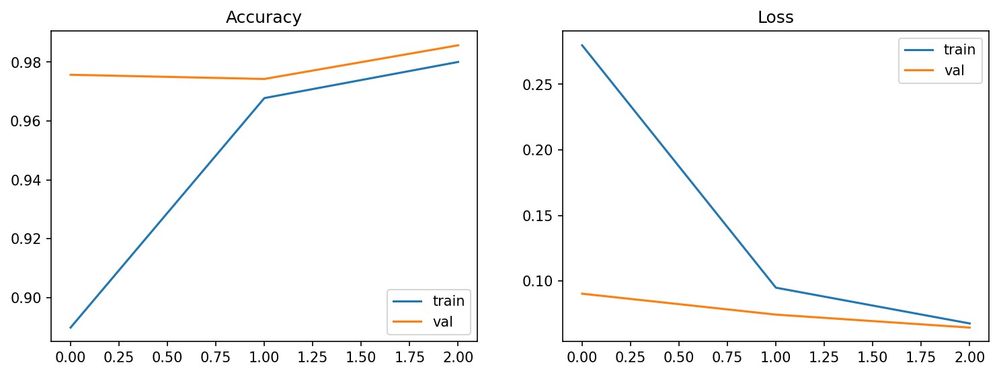
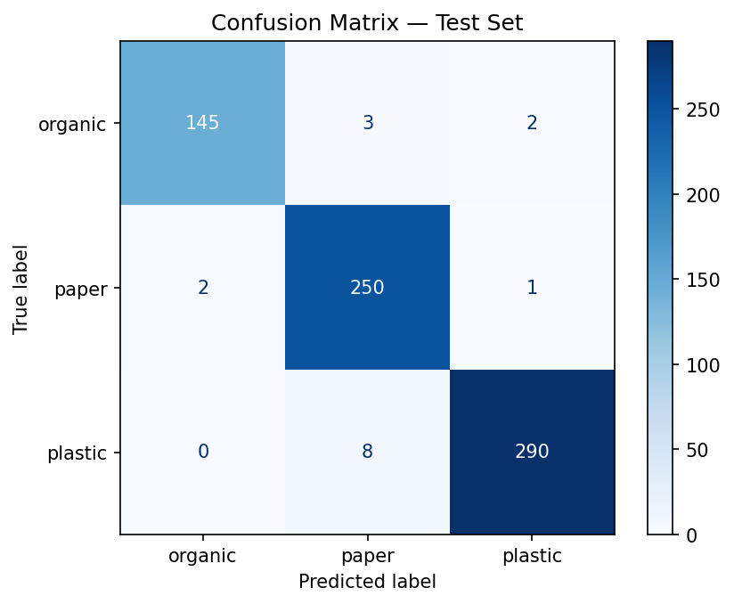

# SWMS ML — Waste Image Classifier API

FastAPI service that classifies a waste photo as **organic**, **paper** or **plastic** using a
MobileNetV2 transfer-learning model. The Express backend calls this service; it is not meant to be
exposed publicly.

## Model

| | |
|---|---|
| Architecture | MobileNetV2 (transfer learning) |
| File | `models/swms_mobilenetv2_best.keras` (Keras 3.13.2) |
| Input | 224×224 RGB |
| Classes (in order) | `organic`, `paper`, `plastic` |
| Test accuracy | **97.72%** |
| Test loss | **0.0800** |

**Dataset:** the training data and the 3 sample images in `tests/samples/` (taken from the test split)
come from the Kaggle [Garbage Classification V2](https://www.kaggle.com/datasets/sumn2u/garbage-classification-v2)
dataset (version 8). Its `biological` class is used as **organic**. See
[Training & Evaluation](#training--evaluation).

**Preprocessing is inside the model.** The model already contains MobileNetV2's preprocessing
(`x / 127.5 − 1`), so the API sends **raw 0–255 RGB pixels**. Do not divide by 255 or call
`preprocess_input` — that would apply it twice and give wrong predictions.

The API resizes images the same way as training (`image_dataset_from_directory`):
`tf.image.resize` to 224×224, bilinear, no antialias, no crop. It additionally applies EXIF
rotation so phone photos are upright (training did not): decode with Pillow → EXIF rotation →
RGB → float32 → resize.

## Setup

Requires [uv](https://docs.astral.sh/uv/). TensorFlow needs Python 3.12 (it does not support 3.14).
Run from the `ml/` folder:

```bash
uv venv .venv --python 3.12
uv pip install -r requirements-dev.txt
```

`requirements.txt` has the runtime packages; `requirements-dev.txt` adds `pytest` and `httpx` for tests.

## Run the API

From `ml/`:

```bash
# Windows
.venv\Scripts\python -m uvicorn src.api.main:app --port 8000

# macOS / Linux
.venv/bin/python -m uvicorn src.api.main:app --port 8000
```

(Or activate the venv first and run `uvicorn src.api.main:app --port 8000`.)
Interactive docs: http://localhost:8000/docs

## Run the tests

From `ml/`:

```bash
.venv\Scripts\python -m pytest        # Windows
.venv/bin/python -m pytest            # macOS / Linux
```

The Colab comparison test checks every image listed in `tests/samples/expected.json`
(see `tests/samples/README.md`) and is skipped if that file is missing.

## Endpoints

### `GET /health`

```bash
curl http://localhost:8000/health
```

```json
{ "status": "ok", "model_loaded": true, "model_version": "swms_mobilenetv2_best" }
```

### `POST /predict`

Send the image as `multipart/form-data` in a field named `file`.
Accepted: **JPEG, PNG, WebP**, up to **5 MB** and **24 million pixels** (about 6000 × 4000). The type is
checked by decoding the image, not by trusting the file name or content type.

Limits are checked as early as possible, so a hostile upload costs little:

- **Body size:** a request body over 5 MB (plus room for the multipart headers) is refused with `413`
  from its `Content-Length` before any of it is read. A chunked upload without `Content-Length` is
  stopped as soon as it passes the limit.
- **Dimensions:** the width and height are read from the image header and checked *before* decoding,
  so a small file that claims huge dimensions (a "decompression bomb") is refused with `400`. Pillow's
  own protection (`Image.MAX_IMAGE_PIXELS`) is set to the same limit as a backstop.
- **Broken files:** truncated, corrupt or non-image files get a `400`/`415`, never a `500`.

```bash
curl -F "file=@tests/samples/plastic_101.jpg" http://localhost:8000/predict
```

```json
{
  "category": "plastic",
  "confidence": 0.9981,
  "probabilities": { "organic": 0.0011, "paper": 0.0008, "plastic": 0.9981 },
  "model_version": "swms_mobilenetv2_best"
}
```

`confidence` is the probability of the predicted `category`. Values are rounded to 4 decimals
(matching the database column `ai_confidence NUMERIC(5,4)`).

### Errors

All errors use the same format as the Express backend:

```json
{ "error": { "message": "Validation failed", "details": [{ "field": "file", "message": "Field required" }] } }
```

| Status | When |
|---|---|
| `400` | No `file` field, empty file, corrupt/truncated image, or image dimensions too large |
| `413` | Request body (file) larger than 5 MB |
| `415` | Not a JPEG, PNG or WebP image (e.g. a text file or GIF) |
| `404` / `405` | Unknown route or wrong HTTP method |
| `500` | Unexpected server error (no internal details are returned) |

## ML Development Process

How the classifier was built, what the numbers mean, and where it falls short. **Every number in this
section comes from a file in this repository**: the notebook output
([`notebooks/garbage_classification.ipynb`](notebooks/garbage_classification.ipynb)), the files in
[`results/`](results/), the split script, or the test samples. Numbers marked *computed* are simple
arithmetic on those values. When a number isn't available, the text says so instead of estimating it.

### 1. Problem & dataset

**Task:** given one photo of waste, predict one of three classes: `organic`, `paper` or `plastic`. The
prediction is used as the report's starting category, and an admin can correct it.

**Source:** Kaggle [Garbage Classification V2](https://www.kaggle.com/datasets/sumn2u/garbage-classification-v2)
by sumn2u, **version 8**, downloaded with the Kaggle API in Colab. Only three of its class folders are used:
`biological` (renamed to `organic`), `paper` and `plastic`. The images are not committed (`ml/dataset/` is
gitignored); the three images in `tests/samples/` come from the test split.

**Size:** 4,661 images, and all 4,661 opened without errors (the notebook checks every file with Pillow:
0 broken files per class).

| Class | Train | Validation | Test | Total | Share of all images (*computed*) |
|---|---|---|---|---|---|
| `organic` | 697 | 150 | 150 | 997 | 21.4% |
| `paper` | 1,175 | 252 | 253 | 1,680 | 36.0% |
| `plastic` | 1,388 | 298 | 298 | 1,984 | 42.6% |
| **Total** | **3,260** | **700** | **701** | **4,661** | 100% |

**How the split was made:** [`scripts/split_dataset.py`](scripts/split_dataset.py) (the notebook's code).
**Each class is split on its own** with scikit-learn's `train_test_split`, `shuffle=True`, `random_state=42`:
first 70% train / 30% rest, then the rest 50/50 into validation and test. Because every class is split
separately, each split keeps the same class proportions: the split is **stratified by construction**,
although the `stratify=` argument isn't used. *Computed*, `organic` is 21.4% of train, 21.4% of validation
and 21.4% of test.

Two caveats:
- The script lists files with `os.listdir`, whose order depends on the file system. The **counts** per split
  are always the same, but on another machine *which* files land in which split can differ.
- The dataset was **not checked for duplicates or near-duplicates** across splits. If it has them, test
  results could be optimistic. Not measured.

### 2. Why transfer learning with MobileNetV2

- **The dataset is small for training a CNN from scratch.** 3,260 training images, of which only 697 are
  `organic`. A convolutional network trained from random weights on that much data would mostly
  memorise the training images. Transfer learning reuses features (edges, textures, shapes)
  that MobileNetV2 already learned on ImageNet, so only a small new head has to learn from our data.
- **Few parameters to learn.** With the base frozen, the model has **3,843 trainable** parameters out of
  **2,261,827** (notebook `model.summary()`). That is why three epochs were enough to reach the results below.
- **Small and fast to serve.** The saved model is **9,667,404 bytes** (`models/swms_mobilenetv2_best.keras`,
  about 9.7 MB, *computed*). MobileNetV2 was designed for mobile and embedded devices, which suits a
  classification API running on CPU behind the backend. Inference latency was **not measured**.
- **Alternatives considered, not trained:**
  - **Training from scratch** was ruled out for the data-size reason above.
  - **Larger backbones** (for example ResNet or bigger EfficientNet variants) would make the model file
    and the CPU inference heavier for a 3-class problem the small model already handles well.

  **No comparison runs were done** for either option, so there are no numbers for them in this
  repository. This choice is a reasoned starting point, not a measured winner.

### 3. Preprocessing

**Training** (`tf.keras.utils.image_dataset_from_directory`):
- Images are decoded by TensorFlow and resized to **224×224** with `tf.image.resize` (bilinear, no
  antialias, no crop; the aspect ratio is not kept).
- **Normalization is part of the model:** the first layers are MobileNetV2's `preprocess_input`
  (`x / 127.5 − 1`, scaling pixels to [-1, 1]; visible as the `TrueDivide` and `Subtract` layers in the
  model summary). The model therefore takes **raw 0–255 pixels**.
- **No data augmentation** was used: the final training run has no flip, rotation, zoom or colour layers.
  There was nothing to restrict to the training set. Augmentation is a candidate for
  [Next steps](#10-next-steps).

**API** ([`src/inference/predictor.py`](src/inference/predictor.py)): decode with Pillow → apply the EXIF
rotation (so phone photos are upright; training did not do this) → RGB → `float32` → `tf.image.resize` to
224×224 (bilinear, `antialias=False`) → model. The pixels are **not** divided by 255 and `preprocess_input`
is **not** called again: doing either would apply the normalization twice and give wrong predictions.

**How parity between training and the API was proven.** Training decodes with TensorFlow and the API
decodes with Pillow, so they could differ in small ways. To check:
1. Notebook cell 28 ran the trained model in Colab on three test-split images, using `tf.io.decode_image` +
   `tf.image.resize`, and printed the probabilities.
2. Those values are stored in [`tests/samples/expected.json`](tests/samples/expected.json), next to the
   images.
3. `test_predict_matches_colab` sends each image through the real `/predict` endpoint and requires the same
   class and every probability within ±0.01.

The measured differences are far smaller than that tolerance. API output versus Colab, re-measured for
this document:

| Image | Class (both) | Largest absolute difference in any class probability |
|---|---|---|
| `biological_102.jpg` | `organic` | 0.0000 |
| `paper_1000.jpg` | `paper` | 0.0001 |
| `plastic_101.jpg` | `plastic` | 0.0002 |

So the API reproduces the training-time predictions to within **0.0002**. Only three images are checked;
the test guards against a broken pipeline (for example normalizing twice), not against every possible decoder
difference.

### 4. Training setup

Exactly as in the final notebook run (cells 19–23) and [`src/training/train.py`](src/training/train.py):

| Setting | Value |
|---|---|
| Base | MobileNetV2, ImageNet weights, `include_top=False`, **frozen** (`trainable = False`, called with `training=False`, so BatchNorm stays in inference mode) |
| Head | `GlobalAveragePooling2D` → `Dropout(0.2)` → `Dense(3, softmax)` |
| Parameters | 3,843 trainable / 2,257,984 frozen / 2,261,827 total |
| Loss | `sparse_categorical_crossentropy` (integer labels) |
| Optimizer | Adam, learning rate **0.001** |
| Batch size | **32** (102 steps per epoch in the training log) |
| Epochs | **3** |
| Callbacks | `ModelCheckpoint(monitor="val_loss", save_best_only=True)` and `EarlyStopping(monitor="val_loss", patience=2, restore_best_weights=True)` |
| Seeds | `seed=42` for shuffling the training set; **no global seed**, so a rerun is not bit-for-bit identical |
| Environment | Colab GPU runtime, TensorFlow 2.21.0 (printed in the notebook) |

Per-epoch history ([`results/metrics/training_history.csv`](results/metrics/training_history.csv)):

| Epoch | Train accuracy | Train loss | Val accuracy | Val loss |
|---|---|---|---|---|
| 1 | 0.8899 | 0.2797 | 0.9757 | 0.0903 |
| 2 | 0.9678 | 0.0949 | 0.9743 | 0.0743 |
| 3 | 0.9801 | 0.0676 | 0.9857 | 0.0645 |

What this shows:
- **Validation loss improved every epoch, so early stopping never fired.** Training ended at the 3-epoch
  limit, and the checkpoint kept epoch 3. The model may not be fully converged; more epochs are an open
  question for [Next steps](#10-next-steps).
- In epoch 1, validation accuracy (0.9757) is higher than training accuracy (0.8899). That is normal here:
  training accuracy is averaged over the epoch while the head is still learning, and dropout is active
  only during training.

**An earlier run was abandoned** (notebook cell 15, not in the scripts): 5 epochs, no callbacks. The
log shows two finished epochs (validation accuracy 0.9771 then 0.9829, validation loss 0.0861 then 0.0676)
before epoch 3 started. The next cells report that `history` and `model` no longer existed (the Colab
session state was lost), and training was re-run with checkpointing. The notebook doesn't record **why
3 epochs** were chosen for the final run.



### 5. Results

On the **701 test images**: accuracy **97.72%** (685 correct, 16 wrong) and loss **0.0800**
([`results/metrics/test_metrics.json`](results/metrics/test_metrics.json); the notebook prints 97.7175%).

Per class ([`results/metrics/classification_report.json`](results/metrics/classification_report.json)):

| Class | Precision | Recall | F1-score | Support |
|---|---|---|---|---|
| `organic` | 0.9864 | 0.9667 | 0.9764 | 150 |
| `paper` | 0.9579 | 0.9881 | 0.9728 | 253 |
| `plastic` | 0.9898 | 0.9732 | 0.9814 | 298 |
| macro avg | 0.9780 | 0.9760 | 0.9769 | 701 |
| weighted avg | 0.9775 | 0.9772 | 0.9772 | 701 |

Confusion matrix ([`results/metrics/confusion_matrix.csv`](results/metrics/confusion_matrix.csv); rows are the
true class, columns the prediction):

| True \ Predicted | `organic` | `paper` | `plastic` |
|---|---|---|---|
| `organic` | **145** | 3 | 2 |
| `paper` | 2 | **250** | 1 |
| `plastic` | 0 | 8 | **290** |



The training curves are in [section 4](#4-training-setup).

**Was the test set used for model selection?** As far as the notebook records, **no**:
- The saved epoch was picked by the checkpoint on **validation** loss.
- The test set was only evaluated afterwards, on that saved model. The notebook evaluates it several times
  (cells 24, 25, 27 and 30, while writing the result files), always the same model with the same 97.72%, and
  nothing was changed or retrained after seeing a test result.
- The 3-epoch setting was chosen after the abandoned first run, whose only visible results were training
  and **validation** numbers.
- The three images in `tests/samples/` come from the test split, but they are only used to check
  API-versus-Colab parity, not to choose anything.

### 6. Class imbalance

The classes are not balanced (see the table in [section 1](#1-problem--dataset)): `plastic` has 1,984 images
and `organic` only 997, about **2.0×** fewer (*computed*: 1,984 / 997 = 1.99). The training set has the
same ratio: 1,388 `plastic` and 697 `organic`.

**Why this matters for overall accuracy.** Accuracy counts every test image equally, so the big classes
dominate it. A useless model that always answered `plastic` would already score **42.5%** on this test
set (*computed*: 298 / 701). A real model can look good overall while doing worse on the small class.

**The fairer view is per-class recall:** of the images that really are class X, how many did the model
find?

| Class | Test images | Found (recall) | Missed |
|---|---|---|---|
| `organic` | 150 | 145 (0.9667) | 5 |
| `paper` | 253 | 250 (0.9881) | 3 |
| `plastic` | 298 | 290 (0.9732) | 8 |

- **The smallest class has the lowest recall.** `organic` is 0.9667, against 0.9772 overall accuracy. That
  fits what imbalance tends to cause, but with 150 test images (5 misses) it isn't proof of it.
- **Macro-averaged recall** (each class counts equally) is **0.9760**, very close to the 0.9772 accuracy, so
  on this test set the imbalance distorts the headline number only a little.
- **Precision shows the other side:** `paper` has the lowest precision (0.9579). Of the 261 images
  predicted as `paper` (*computed* from the confusion matrix), 11 were wrong: 8 `plastic` and 3 `organic`.

**What was done about it: nothing yet.** The assessment brief suggests addressing class balance. The final
model uses no class weights, no oversampling and no augmentation. This is planned work
([Next steps](#10-next-steps)).

### 7. Error analysis

The 16 test errors, from the confusion matrix:

| True → predicted | Count |
|---|---|
| `plastic` → `paper` | **8** |
| `organic` → `paper` | 3 |
| `organic` → `plastic` | 2 |
| `paper` → `organic` | 2 |
| `paper` → `plastic` | 1 |
| `plastic` → `organic` | 0 |

**The main confusion is `plastic` predicted as `paper`:** 8 of 298 plastic test images (2.7%, *computed*),
half of all errors. `paper` is also the class the model over-predicts most (11 of its 16 errors are
predictions of `paper`).

**What the misclassified images have in common: not verified.** The dataset images are not in this
repository (they are gitignored), and the notebook never displays or lists the misclassified files. So I
could not look at them, and there is no grid of examples here. The ideas below are **hypotheses to check,
not findings**:
- **Look-alike surfaces:** plastic packaging with printed labels, or matte, white or flat plastic
  (wrappers, bags, cups), can look like paper or cardboard at 224×224.
- **Mixed materials:** items such as paper cups with a plastic lining or drink cartons could reasonably sit
  in either class, so the dataset label itself may be debatable.
- **Background:** if many paper photos share a similar background, the model may partly rely on the
  background rather than the object.

**How to verify (next Colab session):** list the wrong files and show them in a grid. With `shuffle=False`,
`test_ds.file_paths` lines up with the predictions:

```python
import numpy as np, matplotlib.pyplot as plt
from PIL import Image

test_ds = tf.keras.utils.image_dataset_from_directory(
    f"{BASE}/dataset_split/test", image_size=(224, 224), batch_size=32, shuffle=False)
probs = model.predict(test_ds, verbose=0)
y_true = np.concatenate([y.numpy() for _, y in test_ds])
y_pred = probs.argmax(axis=1)
names = test_ds.class_names
wrong = np.where(y_true != y_pred)[0]

plt.figure(figsize=(16, 9))
for n, i in enumerate(wrong[:16]):
    plt.subplot(4, 4, n + 1)
    plt.imshow(Image.open(test_ds.file_paths[i]).convert("RGB"))
    plt.title(f"{names[y_true[i]]} → {names[y_pred[i]]} ({probs[i].max():.2f})", fontsize=9)
    plt.axis("off")
plt.tight_layout()
plt.savefig(f"{BASE}/results/figures/misclassified.png", dpi=120)
```

Committing `misclassified.png` (16 small dataset images) would turn these hypotheses into findings.

### 8. Limitations

- **No "not waste / unknown" class.** The model must pick one of three labels for *any* image: a selfie, a
  street sign or a glass bottle still comes back as `organic`, `paper` or `plastic`, often with high
  confidence. The admin review step is the safeguard.
- **One object per photo.** Training images show mostly a single item. A photo of a mixed pile still gets one
  label, probably the most prominent material, and the model can't say "this is mixed".
- **Dataset photos are not street photos.** The Kaggle images differ from real reports in lighting,
  background, distance and clutter. Accuracy on real phone photos from the app has **not been measured**;
  the 97.72% only holds for images like the test split.
- **Phone photo pipeline.** The mobile app shrinks photos to at most 1600 px and JPEG-compresses them before
  upload, and the API applies EXIF rotation, which training didn't. The parity test shows the API matches
  Colab on dataset images, but the effect of the phone pipeline on accuracy is untested.
- **Confidence is not a calibrated probability.** `confidence` is the softmax output of the top class. A value
  of 0.95 doesn't mean "right 95% of the time". Calibration was **not measured** (no reliability curve or
  ECE). Treat it as a ranking signal, not a guarantee.
- **Only three materials.** Glass, metal and other waste types in the original dataset were left out, so those
  items are forced into one of the three classes.
- **Not checked:** duplicates across splits ([section 1](#1-problem--dataset)), and run-to-run variance (no
  global seed, single training run).

### 9. Serving

**FastAPI** ([`src/api/main.py`](src/api/main.py)), loaded once at startup:
- **`GET /health`:** `{ status, model_loaded, model_version }`.
- **`POST /predict`:** multipart field `file` → `{ category, confidence, probabilities, model_version }`
  ([details](#post-predict)).

**Input limits** (added in the security fixes, see [`docs/security-audit.md`](../docs/security-audit.md)
SEC-03 and SEC-08):
- **Body size:** a body over 5 MB is refused with `413` from its `Content-Length` **before it's read**,
  and a chunked upload is cut off as soon as it passes the limit.
- **Dimensions:** read from the image header and refused above **24 million pixels** **before decoding**.
  Pillow's own `MAX_IMAGE_PIXELS` is set to the same limit as a backstop. This stops "decompression bomb"
  images, where a small file claims huge dimensions.
- **Format:** only JPEG, PNG and WebP, detected by decoding, not by file name.
- **Broken files:** truncated or corrupt files get `400`/`415`, never `500`.
- **Network:** the documented start command binds to `127.0.0.1`. The API doesn't check an API key yet
  (audit SEC-09), so it must stay on a private network next to the backend.

**How the backend uses a prediction** (Express, `backend/src/modules/ml/ml.service.js` and
`reports.service.js`):
1. **Classify before saving.** When a user submits a report, the backend calls `/predict` *before* saving
   anything. If the ML API rejects the photo, the user gets `422` "The photo couldn't be processed" on the
   image field. If the ML API is down or too slow, they get `503` and nothing is saved.
2. **Set the category automatically.** The report's `category` is set from the prediction, and
   `ai_predicted_category`, `ai_confidence` and `ai_model_version` are stored next to it. Users can't choose
   the category.
3. **Let an admin correct it.** An admin can change `category` in the web panel. The AI fields are never
   edited, so the original prediction stays visible ("AI predicted X, corrected to Y").
4. **Measure accuracy on real reports.** The dashboard's **AI accuracy** is the share of *reviewed* reports
   (status `in_progress` or `completed`, with a prediction) whose final category still equals the AI
   prediction. Over time this measures the model on real app photos, which the test set can't do.

### 10. Next steps

**Option B (planned, not started): class weights + fine-tuning the top of MobileNetV2.**

1. **Class weights.** Weight the loss by inverse class frequency, `weight = total / (classes × count)`. On the
   training counts this gives (*computed*) `organic` 1.559, `paper` 0.925 and `plastic` 0.783, so a missed
   `organic` image costs about twice as much as a missed `plastic` one. Pass them as `class_weight=` to `fit`.
2. **Two-stage fine-tuning.**
   1. Train the head as now.
   2. Unfreeze the top layers of MobileNetV2 and continue with a much lower learning rate (for example 10×
      lower), keeping BatchNorm layers in inference mode, so the pretrained features adapt to waste photos
      without being destroyed.
3. **Possibly augmentation** (random flip, small rotation and zoom, brightness) on the training set only, to
   close part of the gap to real phone photos ([Limitations](#8-limitations)).
4. **Train longer with early stopping.** The current run stopped at the epoch limit while validation loss
   was still falling ([section 4](#4-training-setup)).

**How the results will be compared, so the comparison is fair:**
- **Same data:** the **same split** (reuse the exact `dataset_split/` folder on Google Drive rather than
  re-running the split script, because of the file-order caveat in [section 1](#1-problem--dataset)).
- **Same selection rule:** pick the model by **validation** loss only, and evaluate the test set **once** at
  the end, as for the current model.
- **Same metrics, side by side with today's model:** per-class recall (above all `organic`, the
  smallest class, now 0.9667), the `plastic` → `paper` count (now 8), macro F1 (now 0.9769) and the full
  confusion matrix. Overall accuracy alone could hide a trade-off between classes.
- **Keep the current model as the baseline.** Only replace `models/swms_mobilenetv2_best.keras` if the new one
  is better on these metrics. Then update `expected.json` (the parity samples) and `model_version`, and
  re-run the API tests.

None of these results exist yet; this section describes the plan and how it will be judged.

### Reproduce

The scripts contain the notebook's code (without the earlier, abandoned 5-epoch experiment). Paths are
the Colab/Google Drive paths used in the notebook and are set as constants at the top of each script —
change them to run elsewhere. A GPU is recommended for training.

1. Install the training packages (from `ml/`): `pip install -r requirements-train.txt`.
   These are the versions from the Colab training runtime (Python 3.13). Use a separate environment
   from the API's `.venv` — the numpy version differs.
2. Download the dataset (needs a Kaggle API token in `~/.kaggle/kaggle.json`):
   ```bash
   kaggle datasets download sumn2u/garbage-classification-v2/8 -p /content/kaggle_raw --unzip
   ```
3. Run the three steps from `ml/`:
   ```bash
   python scripts/split_dataset.py        # filter 3 classes + 70/15/15 split
   python -m src.training.train           # train, save best model + training history/curves
   python -m src.evaluation.evaluate      # test metrics, classification report, confusion matrix
   ```

Results can differ slightly from the ones above: no global random seed was set for training, and the
split uses the file system's file order (the number of images per split is always the same).
Do not commit the downloaded dataset — `ml/dataset/` is gitignored.
